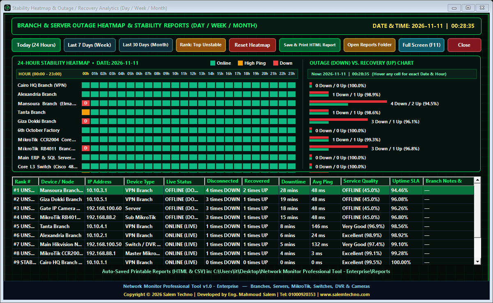

 

# Network Monitor Professional Tool v1.0
### **Free Community Edition & Enterprise NOC Edition Showcase**
### **الأداة الاحترافية لمراقبة الشبكات، فروع الـ VPN، السيرفرات، أجهزة MikroTik، السويتشات وكاميرات المراقبة**

[-00B4D8?style=for-the-badge&logo=github&logoColor=white)](https://github.com/SalemTechno/Network-Monitor-Professional-Tool/archive/refs/heads/main.zip)

**Developed by: Eng. Mahmoud Salem (مهندس محمود سالم)**  
**Company:** [Salem Techno IT Solutions](https://www.salemtechno.com) | **Tel / WhatsApp:** `01000920353`  
**Official Website:** [https://www.salemtechno.com](https://www.salemtechno.com)

---

### 🔗 Quick Navigation | انتقال سريع
[📥 التحميل المباشر (Direct Downloads)](#-repository-folders--direct-downloads--هيكل-المجلدات-والتحميل-المباشر) •
[🔑 باسورد الأدمن وبيانات الدخول (Admin Password)](#-default-login-credentials--بيانات-تسجيل-الدخول-وباسورد-الأدمن) •
[📸 شرح وصور النسخة المجانية (Free Edition Tour)](#-visual-tour--interface-guide-free-edition--شرح-مصوّر-لواجهات-النسخة-المجانية) •
[🚨 الإشعارات الجانبية عند سقوط السيرفرات (Side Alerts)](#-8️⃣-الإشعارات-الجانبية-الفورية-عند-سقوط-سيرفر-أو-فرع-live-side-alert-notifications) •
[🚀 شرح وصور نسخة المؤسسات (Enterprise Edition Showcase)](#-enterprise-edition-showcase) •
[📊 مقارنة الإصدارات (Free vs. Enterprise)](#-comparison-free-edition-vs-enterprise-edition--مقارنة-الإصدارات) •
[👨‍💻 تواصل مع المطور (Contact Developer)](#-developer--contact-information--بيانات-المطور-والتواصل-وطلب-نسخة-المؤسسات)

---

## 📁 Repository Folders & Direct Downloads | هيكل المجلدات والتحميل المباشر

يمكنك **تحميل أي نسخة مباشرة بضغطة واحدة** من الروابط التالية، أو [**📦 تحميل الحزمة الكاملة مضغوطة (Download Full Package ZIP)**](https://github.com/SalemTechno/Network-Monitor-Professional-Tool/archive/refs/heads/main.zip):

| المجلد (Folder) | المحتوى والوصف (Description) | الحجم (Size) | رابط التحميل المباشر (1-Click Direct Download) |
| :--- | :--- | :---: | :---: |
| 📂 [**`1_Portable_Edition`**](./1_Portable_Edition/) | **النسخة المحمولة المباشرة (`Portable EXE`)** — تعمل فوراً بملف واحد بدون تثبيت وبحفظ تلقائي للإعدادات | `684 KB` | [⬇️ **تحميل مباشر للنسخة المحمولة (Portable EXE)**](https://github.com/SalemTechno/Network-Monitor-Professional-Tool/raw/main/1_Portable_Edition/Network%20Monitor%20Professional%20Tool%20v1.0.exe) |
| 📂 [**`2_Setup_Installer_EXE`**](./2_Setup_Installer_EXE/) | **معالج التثبيت القياسي (`Setup Installer EXE`)** — يثبت البرنامج وينشئ اختصارات سطح المكتب وقائمة ابدأ | `1.1 MB` | [⬇️ **تحميل مباشر لمعالج التثبيت (Setup.exe)**](https://github.com/SalemTechno/Network-Monitor-Professional-Tool/raw/main/2_Setup_Installer_EXE/Network_Monitor_Professional_Tool_v1.0_Setup.exe) |
| 📂 [**`3_MSI_Enterprise_Package`**](./3_MSI_Enterprise_Package/) | **حزمة التثبيت المؤسسية (`Windows Installer MSI`)** — مخصصة للتوزيع المركزي عبر Active Directory GPO | `1.1 MB` | [⬇️ **تحميل مباشر لحزمة الـ MSI (Installer.msi)**](https://github.com/SalemTechno/Network-Monitor-Professional-Tool/raw/main/3_MSI_Enterprise_Package/Network_Monitor_Professional_Tool_v1.0.msi) |
| 📂 [**`4_Documentation_and_Guide`**](./4_Documentation_and_Guide/) | **الدليل التفاعلي الشامل باللغة العربية (`HTML5 Guide`)** — شرح كامل لكافة القوائم والخصائص بالصور | `4.1 MB` | [⬇️ **تحميل الدليل التفاعلي (Arabic HTML5 Guide)**](https://github.com/SalemTechno/Network-Monitor-Professional-Tool/raw/main/4_Documentation_and_Guide/Network_Monitor_Pro_Arabic_Guide_HTML5.html) |
| 📂 [**`5_Screenshots_and_Assets`**](./5_Screenshots_and_Assets/) | **معرض صور الواجهات والشعارات (`Screenshots & Assets`)** — يضم صور النسخة المجانية ونسخة المؤسسات `Enterprise` | `21 PNGs` | [🖼️ **تصفح مجلد الصور (Screenshots Folder)**](./5_Screenshots_and_Assets/) |
| 📦 **`Full Repository ZIP`** | **الحزمة الكاملة (`All Editions + Guide + Screenshots ZIP`)** — جميع الملفات والمجلدات في ملف مضغوط واحد | `6.8 MB` | [📦 **تحميل الحزمة الكاملة مضغوطة (Download All as ZIP)**](https://github.com/SalemTechno/Network-Monitor-Professional-Tool/archive/refs/heads/main.zip) |

> 💡 **ملاحظة للتثبيت الصامت (Silent Deployment for IT Admins):**
> - لتثبيت نسخة `Setup.exe` صامتاً: `Network_Monitor_Professional_Tool_v1.0_Setup.exe /S`
> - لتثبيت حزمة `MSI` صامتاً: `msiexec /i Network_Monitor_Professional_Tool_v1.0.msi /qn`

---

## 🔑 Default Login Credentials | بيانات تسجيل الدخول وباسورد الأدمن

عند تشغيل البرنامج لأول مرة، استخدم بيانات الدخول الافتراضية التالية (ويمكنك تغييرها في أي وقت من داخل نافذة **`Admin Settings`**):

| الصلاحية (Access Role) | اسم المستخدم (Username) | كلمة المرور الافتراضية (Password) | الصلاحيات المتاحة (Permissions) |
| :--- | :---: | :---: | :--- |
| 🛡️ **مدير النظام (`Administrator - Full Control`)** | **`admin`** | **`Admin@Salemtechno`** | تحكم كامل: إضافة وتعديل وحذف الفروع والسيرفرات، ضبط السرينة، وتغيير الإعدادات |
| 👁️ **المشرف / المراقب (`Supervisor - Monitor Only`)** | **`supervisor`** | **`IT@Salemtechno`** | متابعة الشاشة الحية والخرائط الحرارية والتقارير (مع صلاحيات يحددها الأدمن) |

---

## 🌟 Overview | نبذة عن النظام

**Network Monitor Professional Tool v1.0** هو نظام غرفة عمليات شبكات (**NOC Dashboard**) متكامل تم تصميمه وتطويره خصيصاً لمديري الشبكات ومهندسي الـ IT وفرق الدعم الفني لمراقبة استقرار **فروع الـ VPN** و**السيرفرات الحيوية** لحظة بلحظة على مدار الساعة (`24/7`).

<i>الشاشة الرئيسية للنسخة المجانية (Free Edition NOC Dashboard) — مراقبة حية لفروع الـ VPN والسيرفرات مع الخريطة الحرارية والترمينال التشخيصي</i>

---

## ✨ Key Features (Free Edition) | المميزات الرئيسية للنسخة المجانية

### 1. 🌐 Intelligent ISP Health Guard (الفحص الذكي لحالة الإنترنت الرئيسي)
- يقوم البرنامج بفحص استقرار خط الإنترنت الرئيسي (`ISP Gateway / 8.8.8.8 / 1.1.1.1`) قبل إصدار أي إنذار كاذب بسقوط الفروع.
- في حال انقطاع الإنترنت من المصدر الرئيسي، يتم تمييز الحالة تلقائياً لتنبيه مهندس الشبكة بأن العطل من مزود الخدمة (`ISP`) وليس من الفرع.

### 2. 📊 Dual Split-Screen Live NOC Matrix (لوحة مراقبة مزدوجة للفروع والسيرفرات)
- **قسم خاص بفروع الـ VPN (`VPN Branches Monitor`):** يعرض حالة كل فرع (`ONLINE`, `HIGH PING`, `DOWN`, `MUTED`) مع زمن الاستجابة اللحظي (`ms`), أقل وأعلى ومتوسط البنج (`Min / Avg / Max`), ومخطط موجي حي (`Live Waveform Sparkline`).
- **قسم خاص بالسيرفرات (`Servers & Critical Hosts Monitor`):** يراقب سيرفرات الـ Active Directory, قواعد البيانات SQL, والأنظمة الداخلية مع عداد دقيق لمدة الانقطاع (`DOWN Duration`) ووقت الاستعادة (`Recovery Time`).

### 3. 🚨 Dual-Tier Siren Alert Engine & Side Popup Notifications (نظام الإنذار الصوتي والإشعارات الجانبية الفورية)
- **إنذار تحذيري (`Warning Alert`):** عند ارتفاع البنج أو بداية التقطيع قبل السقوط الكامل.
- **إنذار طوارئ (`Critical Down Siren`):** صافرة إنذار مستمرة عند سقوط أي فرع أو سيرفر بعد تجاوز عدد المحاولات المحدد (`Confirm Threshold`), مع إمكانية تخصيص ملفات صوت `.WAV` خارجية أو كتم صوت فرع معين (`Mute 15m`).
- **إشعارات جانبية منبثقة فورية (`Live Side Popup Notifications`):** تظهر تلقائياً في جانب الشاشة فوق كافة نوافذ ويندوز فور سقوط أي سيرفر أو فرع مع عرض اسم السيرفر، عنوان الـ IP، مدة الانقطاع (`TIMEOUT`), وأزرار الكتم المؤقت (`Mute 15m`) أو الإغلاق (`Dismiss`).

### 4. 🗓️ Multi-Range Stability Heatmaps (خرائط حرارية للاستقرار: 24 ساعة / 7 أيام / 30 يوماً)
- تسجيل تاريخي مستمر لحالة كل فرع وسيرفر مع عرض بصري فوري:
  - **اليوم (`Day - 24h`):** 24 مربعاً تمثل كل ساعة في اليوم.
  - **الأسبوع (`Week - 7d`):** استقرار كل يوم خلال آخر 7 أيام.
  - **الشهر (`Month - 30d`):** سجل كامل لآخر 30 يوماً مع نسبة الاستقرار المئوية (`Uptime %`) وعدد مرات السقوط والعودة (`Down / Up Count`).

### 5. 🖨️ Executive HTML5 & Printable SLA Reports (تقارير عربية وإنجليزية جاهزة للطباعة)
- بضغطة زر واحدة على **`Save & Print Report`**، يقوم النظام بتوليد تقرير رسمي منسق وجاهز للطباعة (`A4 Landscape`) أو الحفظ كـ `PDF / HTML` يتضمن ملخص الحالة التنفيذي، جدول استقرار الـ 30 يوماً، وسجل الأعطال التفصيلي لتقديمه للإدارة العليا.

### 6. 🛡️ Role-Based Access Control (نظام صلاحيات المسؤول والمشرف)
- حفظ تلقائي لكافة الإعدادات وبيانات الفروع والسيرفرات وسجلات الاستقرار محلياً.
- نظام صلاحيات مزدوج (**`Admin`** للتحكم الكامل وإضافة/تعديل الفروع والإعدادات، و**`Supervisor / Viewer`** للمراقبة فقط في شاشات العرض وغرف العمليات).

---

## 📸 Visual Tour & Interface Guide (Free Edition) | شرح مصوّر لواجهات النسخة المجانية

### 1️⃣ شاشة تسجيل الدخول ونظام الصلاحيات (Access Control Login)
واجهة دخول تدعم التبديل بين حساب المسؤول (`Administrator`: اسم المستخدم **`admin`** / الباسورد **`Admin@Salemtechno`**) وحساب المشرف (`Supervisor`: اسم المستخدم **`supervisor`** / الباسورد **`IT@Salemtechno`**) مع حفظ تلقائي للإعدادات.

---

### 2️⃣ لوحة التحكم الرئيسية (Main NOC Live Dashboard)
تعرض في الأعلى شريط الإحصائيات اللحظي (`ONLINE`, `HIGH PING / WARN`, `CRITICAL / DOWN`, `30D DOWN / UP`), يليه شريط الأدوات السريع، ثم مصفوفة الفروع على اليسار ومصفوفة السيرفرات على اليمين، وفي الأسفل الخريطة الحرارية وسجل الأحداث اللحظي (`Live Cyber Terminal`).

---

### 3️⃣ نافذة إضافة وتعديل فرع أو سيرفر (Node Configuration Editor)
تتيح تحديد اسم الفرع أو السيرفر، عنوان الـ `IP` أو `Hostname`، التصنيف (`VPN Branch` أو `Server / Host`)، حد البنج التحذيري (`Warn Latency ms`)، وتفعيل أو كتم التنبيه الصوتي لهذه النقطة بشكل مستقل.

---

### 4️⃣ إعدادات المسؤول ونظام الإنذار (Admin Settings & Siren Configuration)
لوحة تحكم شاملة لضبط الفاصل الزمني للفحص (`Poll Interval`), مهلة الاتصال (`Ping Timeout`), عدد المحاولات لتأكيد السقوط (`Confirm Retries`), إعدادات فحص الإنترنت الرئيسي (`ISP Check`), اختيار ملفات صوت الإنذار `.WAV`, وإدارة صلاحيات وكلمات مرور الحسابات.

---

### 5️⃣ الخريطة الحرارية الشهرية — 30 يوماً (30-Day Monthly Stability Heatmap)
تحليل تفصيلي لاستقرار كل فرع وسيرفر على مدار 30 يوماً كاملة مع حساب تلقائي لنسبة التواجد (`Uptime %`) وإجمالي حالات الانقطاع والعودة.

---

### 6️⃣ الخريطة الحرارية اليومية — 24 ساعة (24-Hour Hourly Stability Heatmap)
مراقبة دقيقة ساعة بساعة على مدار الـ 24 ساعة لتحديد أوقات الذروة أو التقطيع المتكرر في الفروع والخطوط.

---

### 7️⃣ نافذة الفحص الحي وتتبع المسار واختيار فترة التقرير (Live Inspector & Printable Report)
معاينة حية مكبرة لأي فرع أو سيرفر مع زر `Live Traceroute` وإمكانية اختيار فترة التقرير (`24 ساعة / 7 أيام / 30 يوماً`) للطباعة الفورية.

---

### 8️⃣ الإشعارات الجانبية الفورية عند سقوط سيرفر أو فرع (Live Side Alert Notifications)
عند سقوط أي سيرفر (مثل `Main ERP & SQL Server` أو `VoIP PBX Server`) أو حدوث سقوط جماعي، تنبثق إشعارات طوارئ جانبية متراصة في الركن الأيمن من الشاشة تعرض اسم السيرفر، الـ IP، ومدة الانقطاع المستمرة (`TIMEOUT 9m 24s`) مع أزرار تحكم سريعة لكتم الصوت لمدة 15 دقيقة (`Mute 15m`) أو إغلاق الإشعار (`Dismiss`):

---

### 9️⃣ نافذة حول البرنامج وبيانات المطور (About & Developer Info)
توضح إصدار البرنامج، مواصفات النظام، وبيانات التواصل المباشر مع المطور **مهندس محمود سالم — Salem Techno IT Solutions**.

---

 

 

# 🚀 Enterprise Edition Showcase
## **شرح واستعراض نسخة المؤسسات الاحترافية (Enterprise NOC Edition)**
### **`Network Monitor Professional Tool v1.0 - Enterprise`**

بالإضافة إلى النسخة المجانية المرفوعة في هذا المستودع، تتوفر نسخة المؤسسات المتقدمة **(`Enterprise Edition`)** المصممة للشركات الكبرى، المصانع، البنوك، ومراكز البيانات التي تحتاج إلى **ربط مباشر مع أجهزة MikroTik RouterOS API**، ومراقبة السويتشات وكاميرات المراقبة وأجهزة الـ NVR/DVR، وحساب مؤشرات جودة الخدمة **`QoS % / Packet Loss % / Jitter`**، وإعادة تشغيل الأجهزة عن بُعد **`Remote Reboot`**.

---

## 🔥 المميزات الحصرية في نسخة المؤسسات (Enterprise Exclusive Capabilities)

1. **📡 الربط المباشر مع أجهزة مايكروتك (`MikroTik RouterOS API Concentrator - Port 8728`):**
   - لوحة علوية مخصصة لراوتر المايكروتك الرئيسي بالمركز الرئيسي (**`MASTER MKT`**) وراوترات الفروع (**`SUB-MKT`**).
   - سحب ومراقبة خطوط وفروع الـ VPN (`PPTP / L2TP / SSTP / OpenVPN / WireGuard / GRE / EoIP`) مباشرة من داخل المايكروتك.
   - عرض معدل سحب الترافيك اللحظي (**`Pull: ↓ kbps / ↑ kbps`**), زمن التشغيل (**`Uptime`**), ومؤشر جودة الخط (**`QoS %`**).
   - أزرار تحكم فورية على شريط المايكروتك: فحص فوري (**`Check`**), تتبع المسار (**`Trace`**), وإعادة تشغيل الراوتر عن بُعد (**`Reboot`**).

2. **🔌 مراقبة شاملة لكافة معدات الشبكة والبروتوكولات (`ICMP + TCP Ports + HTTP/HTTPS`):**
   - مراقبة **فروع الـ VPN (`VPN Branches`)**، **السيرفرات (`Windows / Linux / SQL / ERP Servers`)**، **راوترات المايكروتك (`MikroTik Routers`)**، **السويتشات المدارة (`Cisco / HP / Aruba L2 & L3 Switches`)**، و**أنظمة الكاميرات والتسجيل (`Hikvision / Dahua NVR, DVR & IP Cameras`)**.
   - دعم الفحص عبر **`ICMP Ping`** أو فحص بورتات الخدمة **`TCP Port (مثل 80, 443, 3389, 8291, 8728, 554, 1433)`** أو **`HTTP/HTTPS Status`**.

3. **📈 تحليل متقدم لجودة الاتصال (`Live QoS %, Packet Loss % & Jitter ms`):**
   - تعرض كل بطاقة جهاز في نسخة المؤسسات نسبة جودة الاتصال اللحظية (**`QoS: 99.7%`**), نسبة فقدان الحزم (**`Loss: 0%`**), ومعدل التذبذب (**`Jitter ms`**) لاكتشاف ضعف الخطوط قبل انقطاعها.

4. **🛠️ أدوات تحكم وتشخيص عن بُعد (`Remote Reboot & Multi-Hop Traceroute`):**
   - إمكانية عمل **`Reboot`** عن بُعد للسيرفرات أو راوترات المايكروتك أو الأجهزة المدعومة مباشرة من داخل البرنامج مع تسجيل العملية في سجل الأحداث.
   - أداة **`Trace`** مدمجة لتتبع مسار الحزم (`Hop-by-Hop Traceroute`) ومعرفة النقطة المسببة للبطء أو الانقطاع فوراً.

5. **🔔 مركز الإشعارات الموحد (`Unified Notifications Center — Gmail SMTP & 5 WhatsApp Gateways`):**
   - إرسال إشعارات فورية تلقائية عبر البريد الإلكتروني (**`smtp.gmail.com` TLS 587**) وبوابات الواتساب الخمس (**`CallMeBot` / `UltraMsg` / `Green-API` / `Meta Cloud API v20.0` / `Custom Webhook`**) عند انقطاع الخدمة (`DOWN`), استعادتها (`RECOVERED`), أو عدم استقرار البنج (`UNSTABLE`).

6. **📉 تقرير عدم استقرار الخدمة وتقطيع البنج (`Service Instability & Ping Flapping Report`):**
   - تقرير تحليلي مفصل ومستقل يرصد نوبات قطع البنج السريعة التي تعود قبل مهلة تأكيد الانقطاع (`UNSTABLE — NOT DOWN`), مع خريطة توزيع الـ 24 ساعة، حفظ وطباعة التقرير من داخل نافذته، ودعم التكبير **`F11 Full Screen`**.

7. **💾 نسخ احتياطي مشفر واستعادة سريعة للإعدادات (`AES-256 Encrypted Vault & Export / Import Config`):**
   - تصدير واستيراد قائمة الفروع والسيرفرات والإعدادات المشفرة بالكامل في ملف خارجي جاهز ونقلها لأي جهاز آخر في ثوانٍ.

---

## 📊 Comparison: Free Edition vs. Enterprise Edition | مقارنة الإصدارات

| الميزة / الإمكانية (Feature) | النسخة المجانية (Free Edition) | نسخة المؤسسات (Enterprise Edition) |
| :--- | :---: | :---: |
| **مراقبة فروع الـ VPN والسيرفرات (`ICMP Ping`)** | ✅ مدعوم بالكامل | ✅ مدعوم بالكامل |
| **الفحص الذكي لخط الإنترنت الرئيسي (`ISP Health Guard`)** | ✅ مدعوم | ✅ مدعوم |
| **نظام الإنذار الصوتي المزدوج (`Dual-Tier WAV Siren`)** | ✅ مدعوم | ✅ مدعوم |
| **الإشعارات الجانبية المنبثقة عند سقوط السيرفرات (`Live Side Alerts`)** | ✅ مدعوم | ✅ مدعوم |
| **الخرائط الحرارية (`24h / 7d / 30d Stability Heatmaps`)** | ✅ مدعوم | ✅ مدعوم + مؤشرات `QoS %` |
| **تقارير SLA الرسمية الجاهزة للطباعة (`Printable HTML5 Reports`)** | ✅ مدعوم | ✅ مدعوم + تقارير `QoS & Loss` |
| **نظام صلاحيات `Admin / Supervisor` وحفظ تلقائي للإعدادات** | ✅ مدعوم | ✅ مدعوم |
| **ربط مباشر مع راوترات `MikroTik RouterOS API (Port 8728)`** | ❌ غير متاح | ✅ **حصري في نسخة Enterprise** |
| **لوحة `MASTER MKT` و `SUB-MKT` مع سحب الترافيك الحي (`↓/↑ kbps`)** | ❌ غير متاح | ✅ **حصري في نسخة Enterprise** |
| **فحص البورتات والخدمات (`TCP Port Check & HTTP/HTTPS`)** | ❌ غير متاح | ✅ **حصري في نسخة Enterprise** |
| **مراقبة السويتشات وأجهزة `DVR / NVR` وكاميرات `IP Cameras`** | ❌ غير متاح | ✅ **حصري في نسخة Enterprise** |
| **حساب جودة الخدمة (`QoS %`) وفقدان الحزم (`Loss %`) والـ `Jitter`** | ❌ غير متاح | ✅ **حصري في نسخة Enterprise** |
| **إعادة تشغيل الأجهزة عن بُعد (`Remote Reboot`) وتتبع المسار (`Trace`)** | ❌ غير متاح | ✅ **حصري في نسخة Enterprise** |
| **تصدير واستيراد الإعدادات (`Export / Import Config`)** | ❌ غير متاح | ✅ **حصري في نسخة Enterprise** |

---

## 🖼️ جولة مصوّرة وشرح تفصيلي لنسخة المؤسسات (Enterprise Visual Walkthrough)

### 1️⃣ اللوحة الرئيسية لنسخة المؤسسات (Enterprise Live NOC & MikroTik Concentrator)
تظهر في هذه الشاشة لوحة المايكروتك الرئيسي (**`MASTER MKT — MikroTik CCR2004 Core Router`**) متصلاً عبر `RouterOS API` مع عرض الترافيك الحي (`Pull: ↓0.4 / ↑0.4 kbps`) ونسبة الجودة (`QoS: 99.7%`) وأزرار **`Check` / `Trace` / `Reboot`**، يليها راوتر الفرع (**`SUB-MKT — MikroTik RB4011`**)، ثم مصفوفة فروع الـ VPN ومصفوفة السيرفرات والسويتشات وأجهزة الـ NVR/DVR مع مؤشرات الـ `QoS %` والـ `Loss %` لكل نقطة:

---

### 2️⃣ بوابة الدخول ونظام الصلاحيات لنسخة المؤسسات (Enterprise Login Portal)
شاشة الدخول الخاصة بإصدار **`Enterprise Edition`** مع دعم حسابات المسؤول (`Administrator`) والمشرف (`Supervisor`):

---

### 3️⃣ نافذة إضافة وإعداد راوتر MikroTik والسيرفرات والكاميرات (Enterprise Node & Protocol Editor)
تمكّن مهندس الشبكة من تحديد نوع الجهاز (`MikroTik Core / Sub Router`, `VPN Branch`, `Windows / Linux Server`, `Managed Switch`, `DVR / NVR / IP Camera`)، اختيار بروتوكول الفحص (`ICMP Ping`, `TCP Port`, `RouterOS API`)، وإدخال بيانات الاتصال وبورت الـ API أو أوامر الـ `Remote Reboot`:

---

### 4️⃣ إعدادات المسؤول والنسخ الاحتياطي للإعدادات (Enterprise Admin Settings & Config Backup)
تتيح ضبط معايير حساب الـ `QoS %`، فترات الفحص، إعدادات صافرات الإنذار، بالإضافة إلى تصدير واستيراد ملفات الإعدادات (`Export Config` / `Import Config`):

---

### 5️⃣ الخريطة الحرارية الشهرية 30 يوماً ومؤشرات الجودة (Enterprise 30-Day QoS & Stability Heatmap)
تعرض سجل الاستقرار الكامل لآخر 30 يوماً لكافة الفروع، راوترات المايكروتك، السيرفرات، السويتشات، وأجهزة الـ NVR مع نسب التواجد (`Uptime %`) ومؤشرات الجودة:

---

### 6️⃣ الخريطة الحرارية اليومية 24 ساعة لنسخة المؤسسات (Enterprise 24-Hour Stability Matrix)
متابعة دقيقة على مدار 24 ساعة لكافة خطوط الربط والسيرفرات ومعدات الشبكة:

---

### 7️⃣ الإشعارات الجانبية عند سقوط السيرفرات في نسخة المؤسسات (Enterprise Server-Down Side Alerts)
ظهور الإشعارات الجانبية الفورية على يمين الشاشة في نسخة المؤسسات عند توقف أي سيرفر أو نقطة حيوية مع أزرار الكتم المؤقت (`Mute 15m`) والإغلاق (`Dismiss`):

---

### 8️⃣ بطاقة معلومات نسخة المؤسسات وبيانات المطور (Enterprise About & Licensing Dialog)
توضح تفاصيل إصدار **`Network Monitor Professional Tool v1.0 - Enterprise`** وبيانات التواصل المباشر للحصول على النسخة المؤسسية والدعم الفني:

---

## 🚀 Quick Start Guide | دليل التشغيل السريع

1. **التحميل المباشر للنسخة المناسبة:**
   - [⬇️ **تحميل النسخة المحمولة المباشرة (`Portable EXE`)**](https://github.com/SalemTechno/Network-Monitor-Professional-Tool/raw/main/1_Portable_Edition/Network%20Monitor%20Professional%20Tool%20v1.0.exe)
   - [⬇️ **تحميل معالج التثبيت (`Setup.exe`)**](https://github.com/SalemTechno/Network-Monitor-Professional-Tool/raw/main/2_Setup_Installer_EXE/Network_Monitor_Professional_Tool_v1.0_Setup.exe)
   - [⬇️ **تحميل حزمة الشركات (`Installer.msi`)**](https://github.com/SalemTechno/Network-Monitor-Professional-Tool/raw/main/3_MSI_Enterprise_Package/Network_Monitor_Professional_Tool_v1.0.msi)
   - [📦 **تحميل الحزمة الكاملة مضغوطة (`Full ZIP`)**](https://github.com/SalemTechno/Network-Monitor-Professional-Tool/archive/refs/heads/main.zip)
2. **تسجيل الدخول بالبيانات الافتراضية:**
   - **حساب الأدمن (`Administrator`):** اسم المستخدم `admin` | كلمة المرور `Admin@Salemtechno`
   - **حساب المشرف (`Supervisor`):** اسم المستخدم `supervisor` | كلمة المرور `IT@Salemtechno`
3. **إضافة الفروع والسيرفرات:**
   - اضغط على زر **`+ Add Branch / Server`** في أعلى اليسار لإضافة عناوين الـ IP الخاصة بفروع الـ VPN والسيرفرات الخاصة بك.
4. **تفعيل وضع شاشة غرفة العمليات (`NOC Wallboard Mode`):**
   - اضغط على **`Full Screen (F11)`** لعرض اللوحة بملء الشاشة على شاشات المراقبة في قسم الـ IT.

---

## 💻 System Requirements | متطلبات التشغيل

- **Operating System:** Windows 10 / Windows 11 / Windows Server 2016, 2019, 2022, 2025 (64-bit & 32-bit)
- **Runtime:** Built-in `.NET Framework 4.8` (موجود افتراضياً في كافة أنظمة ويندوز الحديثة بدون الحاجة لتحميل أي حزم إضافية)
- **Footprint:** خفيف جداً على موارد الجهاز (أقل من `1% CPU` و `35 MB RAM`)

---

## 👨‍💻 Developer & Contact Information | بيانات المطور والتواصل وطلب نسخة المؤسسات

لطلب **نسخة المؤسسات (`Enterprise Edition`)** أو لخدمات التخصيص والدعم الفني وحلول الشبكات والسيرفرات، يسعدنا تواصلكم المباشر:

| البيان (Field) | التفاصيل (Details) |
| :--- | :--- |
| **المطور (Developer)** | **Eng. Mahmoud Salem — مهندس محمود سالم** |
| **الشركة (Company)** | **Salem Techno IT Solutions** |
| **الهاتف / واتساب (Tel / WhatsApp)** | **`01000920353`** |
| **الموقع الرسمي (Official Website)** | 🌐 **[https://www.salemtechno.com](https://www.salemtechno.com)** |
| **مستودع GitHub الرسمي** | 🔗 **[github.com/SalemTechno/Network-Monitor-Professional-Tool](https://github.com/SalemTechno/Network-Monitor-Professional-Tool)** |

 

**Copyright © 2026 [Salem Techno IT Solutions](https://www.salemtechno.com) — Developed by Eng. Mahmoud Salem (`01000920353`). All Rights Reserved.**

