

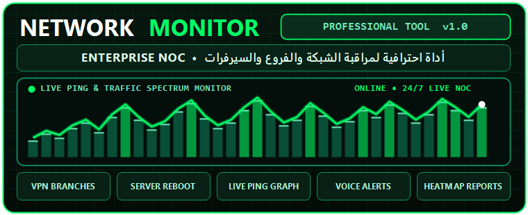

  

# 🛡️ Network Monitor Professional Tool v1.0
### **Real-Time NOC Network, VPN Branch, Server, MikroTik, Firewall & ISP Router Monitoring Suite**
### **المنظومة الاحترافية المتكاملة لمراقبة الشبكات، فروع الـ VPN، السيرفرات، أجهزة MikroTik، الفايروول وراوترات الإنترنت**

**Developed by: Eng. Mahmoud Salem (مهندس محمود سالم) — [Salem Techno IT Solutions](https://www.salemtechno.com)**
📞 **Phone / WhatsApp:** [`01000920353`](https://wa.me/201000920353) (`+201000920353`) &nbsp;|&nbsp; 🌐 **Official Website:** [www.salemtechno.com](https://www.salemtechno.com)

 

<!-- Row 1: Core Architecture & Security Badges (Vibrant First-Edition Palette) -->

  
  
  
  
  

<!-- Row 2: Direct Download, Login & Instant Contact Action Badges -->

  
  
  
  

  
  
  

<!-- Row 3: Quick Section Navigation Pills -->

  
  
  
  
  
  

---

## 📖 نبذة تعريفية شاملة | Executive Overview (Arabic & English)

> [!IMPORTANT]
> **🇪🇬 نبذة عن المنظومة (العربية):**
> **Network Monitor Professional Tool v1.0** هي منظومة غرفة عمليات شبكات (**Real-Time 24/7 NOC Monitoring Suite**) احترافية متكاملة لأنظمة **Windows**، صُممت خصيصاً لمهندسي الشبكات، مديري الـ IT، ومسؤولي البنية التحتية لمراقبة استقرار **خطوط الربط بين الفروع (`VPN Branches`)**، **السيرفرات الحيوية (`Windows / Linux / VoIP PBX`)**، **أجهزة الميكروتيك (`Master & Sub MikroTik RouterOS`)**، **جدران الحماية (`Sophos XG/XGS/UTM`)**، **راوترات شركات الإنترنت في مصر (`WE / Vodafone / Orange / Etisalat — Huawei, ZTE, TP-Link, Nokia`)**، **نقاط الواي فاي (`Access Points`)**، **أجهزة الربط اللاسلكي (`Ubiquiti NanoStation AirOS`)**، **السويتشات وكاميرات المراقبة (`NVR / DVR / IP Cameras`)** في شاشة واحدة حية مع نظام إنذار صوتي وبصري فوري، إشعارات **WhatsApp** و **Gmail SMTP**، إعادة تشغيل عن بُعد وجدولة تلقائية بنظام **12 ساعة (`AM/PM`)**، وخرائط حرارية وتقارير تنفيذية جاهزة للطباعة العرضية المرقمة.

> [!NOTE]
> **🇬🇧 Executive Overview (English):**
> **Network Monitor Professional Tool v1.0** is an enterprise-grade, zero-dependency **24/7 Network Operations Center (NOC) Monitoring Suite** engineered for IT Directors, Network Engineers, and System Administrators on **Windows Desktop & Windows Server**. It provides real-time telemetry, live ping waveforms, **HQ ISP & DNS (`8.8.8.8` / `1.1.1.1`) uplink verification**, **dual-tier acoustic police sirens & custom spoken `.WAV` voice alerts**, **instant desktop side-toast outage popups**, **encrypted right-click remote reboot & 12-hour (`AM/PM`) scheduled auto-reboot**, **multi-gateway WhatsApp alerts (Built-in Persistent QR Session + Official Meta Cloud API + 1-to-4 recipient numbers with anti-ban templates) & Gmail SMTP alerts**, **24h / 7d / 30d stability & QoS heatmaps**, **ping-flapping instability analytics (`UNSTABLE — NOT DOWN`)**, and **A4 landscape page-numbered printable SLA reports**.

### 🎯 هيكل هذا الدليل | How This Documentation Is Organized
- **[🟢 القسم الأول (PART I — Free Community Edition)](#free-edition):** شرح كامل ومفصل **عربي + إنجليزي** للنسخة المجانية المرفقة للتحميل المباشر في هذا المستودع، مع شرح مصور **لكل شاشة وكل خاصية وكل إعداد بالتفصيل (9 شاشات كاملة)**.
- **[🚀 القسم الثاني (PART II — Enterprise NOC Edition)](#enterprise-edition):** شرح كامل ومفصل **عربي + إنجليزي** لنسخة المؤسسات الاحترافية المفتوحة بالكامل، مع شرح مصور **لكل شاشة ولكافة الأنظمة والإعدادات الحصرية بالتفصيل (16 شاشة كاملة)**.
- **[⚖️ القسم الثالث (PART III — Free vs. Enterprise Matrix)](#comparison):** جدول مقارنة شامل ودقيق باللغتين العربية والإنجليزية بين الإصدارين.

---

## 📦 التحميل المباشر وهيكل المجلدات | Direct Downloads & Repository Structure

**🇪🇬 العربية:** جميع حزم التوزيع الرسمية للنسخة المجانية (**Free Community Edition**) مرفقة مباشرة داخل هذا المستودع وجاهزة للتشغيل الفوري بدون أي متطلبات خارجية، مع بصمة التحقق الأمنية (`SHA-256`):
**🇬🇧 English:** All official binary distribution packages for the **Free Community Edition** are hosted directly in this repository for immediate 1-click download and deployment on Windows, verified with cryptographic `SHA-256` checksums:

| المجلد / الحزمة (Folder / Package) | الوصف الكامل بالعربية والإنجليزية (Bilingual Description) | الحجم (Size) | التحميل المباشر (1-Click Download) |
| :--- | :--- | :---: | :---: |
| 📂 [**`1_Portable_Edition`**](./1_Portable_Edition/) | **🇪🇬 النسخة المحمولة المشفرة (`Portable EXE`):** تعمل فوراً بملف تنفيذي واحد بدون تثبيت وتحفظ الإعدادات تلقائياً. **🇬🇧 Standalone Portable EXE:** Zero-install single encrypted executable; runs instantly and persists encrypted vault settings automatically. | `684 KB` |  |
| 📂 [**`2_Setup_Installer_EXE`**](./2_Setup_Installer_EXE/) | **🇪🇬 معالج التثبيت الرسمي (`Setup Wizard EXE`):** يثبت البرنامج في `Program Files` وينشئ اختصارات سطح المكتب وقائمة ابدأ. **🇬🇧 Official GUI Setup Wizard:** Installs into `Program Files`, creates Desktop & Start Menu shortcuts, and registers clean uninstaller. | `1.08 MB` |  |
| 📂 [**`3_MSI_Enterprise_Package`**](./3_MSI_Enterprise_Package/) | **🇪🇬 حزمة تثبيت المؤسسات (`Windows Installer MSI`):** مخصصة للنشر الصامت عبر الشبكة و Active Directory GPO. **🇬🇧 Standard Windows MSI Package:** Built for centralized IT deployment via Active Directory Group Policy (GPO) & SCCM/Intune. | `1.10 MB` |  |
| 📂 [**`4_Documentation_and_Guide`**](./4_Documentation_and_Guide/) | **🇪🇬 الدليل التفاعلي المصور (`Arabic HTML5 Guide`):** ملف ويب تفاعلي يعمل بدون إنترنت ويشرح كافة القوائم. **🇬🇧 Offline Interactive HTML5 Guide:** Rich self-contained offline user manual with embedded visual illustrations. | `4.03 MB` |  |
| 📂 [**`5_Screenshots_and_Assets`**](./5_Screenshots_and_Assets/) | **🇪🇬 معرض الصور والشعارات الرسمية:** جميع لقطات الشاشة النقية للنسخة المجانية ونسخة المؤسسات. **🇬🇧 Official Screenshots & Brand Gallery:** Full-resolution synthetic-data UI captures for both Free and Enterprise editions. | `29 PNGs` |  |
| 📦 **`Full Repository Archive`** | **🇪🇬 الحزمة الكاملة المضغوطة (`Full ZIP`):** تحميل جميع النسخ مع الدليل والصور في ملف `ZIP` واحد. **🇬🇧 Complete All-in-One ZIP:** Downloads Portable EXE, Setup EXE, MSI Installer, HTML5 Guide, and assets together. | `~7.5 MB` |  |

> [!TIP]
> **💻 أوامر التثبيت الصامت لمديري الأنظمة | Silent CLI Deployment for IT Administrators:**
> - **Silent EXE Install (تثبيت صامت لملف Setup):** `Network_Monitor_Professional_Tool_v1.0_Setup.exe /S`
> - **Silent MSI GPO Install (تثبيت صامت لحزمة MSI):** `msiexec /i Network_Monitor_Professional_Tool_v1.0.msi /qn`

---

## 🔑 بيانات تسجيل الدخول الافتراضية والصلاحيات | Default Login Credentials & Roles

**🇪🇬 العربية:** عند فتح البرنامج لأول مرة، استخدم بيانات الدخول الافتراضية التالية (ويمكنك تغيير اسم المستخدم وكلمة المرور وتخصيص صلاحيات المشرف في أي وقت من داخل شاشة **`Admin Settings`**):
**🇬🇧 English:** Upon launching the application for the first time, sign in using the default credentials below (both usernames, passwords, and granular Supervisor permissions can be customized anytime inside **`Admin Settings`**):

| مستوى الصلاحية (Access Role) | اسم المستخدم (Username) | كلمة المرور الافتراضية (Default Password) | الصلاحيات المخولة بالتفصيل (Detailed Role Capabilities — AR / EN) |
| :--- | :---: | :---: | :--- |
| 🛡️ **مدير النظام الكامل** **`Administrator (Full Control)`** | **`admin`** | **`Admin@Salemtechno`** | **🇪🇬 تحكم إداري كامل:** إضافة وتعديل وحذف الفروع والسيرفرات، إعادة التشغيل عن بُعد، جدولة الريستارت، ضبط السرينة والصوتيات، ربط الواتساب والإيميل، تفعيل منع السكون `24/7 Keep-Awake`، وتصدير/استيراد النسخ المشفرة. **🇬🇧 Full Administrative Control:** Add/edit/delete nodes, remote reboot, reboot scheduling, siren & audio tuning, WhatsApp/SMTP gateway configuration, 24/7 Keep-Awake, and encrypted vault backup/restore. |
| 👁️ **المشرف / غرفة المراقبة** **`Supervisor (NOC Operator)`** | **`supervisor`** | **`IT@Salemtechno`** | **🇪🇬 صلاحية مراقبة آمنة:** متابعة لوحة الـ NOC الحية، الخرائط الحرارية، وتقارير الاستقرار بدون القدرة على حذف الأجهزة أو تغيير إعدادات الأمان (مع إمكانية منحه صلاحيات محددة مثل البنج أو كتم الصوت أو الريستارت بأمر الأدمن). **🇬🇧 Safe NOC Monitoring Role:** View live NOC dashboard, stability heatmaps, and reports without altering security settings (Admin can selectively grant Ping/Trace, Mute, Edit, or Reboot rights). |

---
---

# 🟢 القسم الأول: شرح النسخة المجانية بالكامل (بالصور والإعدادات)
# PART I: Free Community Edition — Complete Visual & Settings Guide

  
  
  

## ✨ أولاً: ملخص شامل لكافة خواص النسخة المجانية | Complete Free Edition Feature Summary

1. **🌐 مؤشر فحص صحة الإنترنت الرئيسي والـ DNS (`HQ ISP & Global DNS Health Indicator`)**
   - **🇪🇬 عربي:** يفحص البرنامج خط الإنترنت الرئيسي في المقر الرئيسي تلقائياً على مدار الساعة عبر خوادم DNS العالمية (`8.8.8.8` و `1.1.1.1`) في الشريط العلوي، ليوضح لك فوراً هل المشكلة سقوط فعلي في الفرع أم انقطاع في إنترنت المركز الرئيسي نفسه.
   - **🇬🇧 English:** Continuously probes global DNS roots (`8.8.8.8` & `1.1.1.1`) in the top header bar to distinguish instantly between a local HQ ISP uplink outage and genuine remote VPN branch disconnections.

2. **📊 بطاقات فلاتر الحالة التفاعلية بضغطة زر (`Interactive 1-Click KPI Filter Pills`)**
   - **🇪🇬 عربي:** أربع بطاقات علوية ملونة تعرض العدد اللحظي للأجهزة المتصلة (`ONLINE`)، الأجهزة ذات البنج المرتفع (`HIGH PING`)، الأجهزة الفاصلة (`CRITICAL / DOWN`)، وإجمالي حالات الفصل والعودة خلال 30 يوماً (`SHOW ALL`)، وبالضغط على أي بطاقة يتم فلترة الشاشة فوراً.
   - **🇬🇧 English:** Four color-coded top KPI counters (`ONLINE`, `HIGH PING`, `CRITICAL / DOWN`, and `SHOW ALL 30D`). Clicking any counter or using the `Filter` button immediately filters the live dashboard matrix.

3. **📈 رسم بياني موجي حي للبنج وحساب الفقد والتذبذب (`Live Ping Waveform, Packet Loss % & Jitter`)**
   - **🇪🇬 عربي:** تحتوي كل بطاقة فرع أو سيرفر على رسم موجي حي (`Live Ping Traffic Graph`) يعرض سرعة الاستجابة اللحظية والحد الأدنى والمتوسط والأقصى (`Min / Avg / Max ms`)، مع نسبة فقد الحزم (`Loss %`) والتذبذب (`Jitter ±ms`).
   - **🇬🇧 English:** Every monitored node card renders a real-time dynamic latency waveform displaying `Min / Avg / Max` RTT in milliseconds, live `Packet Loss %`, and `Jitter (±ms)`.

4. **⏱️ عداد مدة الانقطاع المستمر اللحظي (`Continuous Outage Duration Timer`)**
   - **🇪🇬 عربي:** فور تأكيد سقوط أي فرع أو سيرفر، يظهر عداد زمني تراكمي دقيق (`TIMEOUT 9m 40s` أو `2h 15m`) يتحدث كل ثانية ليوضح مدة العطل الفعلية المستمرة.
   - **🇬🇧 English:** Displays a live, per-second elapsed outage timer (e.g., `DOWN 9m 40s`) directly on disconnected cards and inside popup alerts until connectivity recovers.

5. **🚨 نظام السرينة الصوتية المزدوج والرسائل الصوتية المنطوقة (`Dual-Tier Police Siren & Spoken .WAV Alerts`)**
   - **🇪🇬 عربي:** يدعم تنبيهات صوتية منطوقة واضحة عند سقوط أي جهاز وعند عودته للعمل، مع إمكانية تخصيص ملف `.WAV` خاص لكل فرع، بالإضافة إلى **سرينة طوارئ مستمرة (`Emergency Mass Outage Police Siren`)** تنطلق تلقائياً عند سقوط عدد محدد من الفروع معاً، وميزة كتم مؤقت لـ `15 دقيقة` ثم إعادة تفعيل تلقائية إذا استمر العطل!
   - **🇬🇧 English:** Combines clear spoken English `.WAV` down/recovery alerts (plus custom per-node `.WAV` files and repeat intervals) with a continuous **Mass Outage Emergency Police Siren** when multiple branches drop simultaneously, complete with `15-Minute Auto-Resume Mute`.

6. **🔔 إشعارات جانبية منبثقة فورية فوق سطح المكتب (`Bottom-Right Stacked Live Outage Toasts`)**
   - **🇪🇬 عربي:** حتى لو كان البرنامج مصغراً بجوار الساعة (`System Tray`)، تنبثق بطاقات تحذيرية حمراء في أسفل يمين الشاشة فور سقوط أي سيرفر أو فرع مع زر كتم سريع (`Mute 15m`) أو إغلاق (`Dismiss`).
   - **🇬🇧 English:** Even when minimized to the Windows System Tray, critical red alert cards slide up in the bottom-right corner of the desktop upon server/branch outages with instant `Mute 15m` and `Dismiss` actions.

7. **🔄 إعادة تشغيل السيرفرات عن بُعد بكليك يمين (`Encrypted Right-Click Remote Server Reboot`)**
   - **🇪🇬 عربي:** إمكانية حفظ بيانات دخول السيرفر بتشفير `AES-256` (`Windows WMI/RPC` أو `Linux SSH` أو `Asterisk/Issabel PBX SSH`) وعمل **Right-Click -> Remote Reboot** لإعادة تشغيل السيرفر المتجمد بضغطة زر.
   - **🇬🇧 English:** Stores `AES-256` encrypted credentials for `Windows Server (WMI/RPC)`, `Linux SSH`, or `Asterisk/Issabel VoIP PBX SSH`, enabling authorized admins to right-click any server card and trigger an immediate remote reboot.

8. **🗓️ خرائط الاستقرار الحرارية وتقارير الـ SLA العرضية المرقمة (`24h / 7d / 30d Heatmaps & Landscape Reports`)**
   - **🇪🇬 عربي:** خرائط حرارية تفاعلية لـ `24 ساعة` (بنظام **12 ساعة `AM/PM`**) و`7 أيام` و`30 يوماً` مع ترتيب تلقائي للفروع الأكثر انقطاعاً (`Top Unstable Ranking`)، زر تصفير السجل (`Reset Heatmap`)، وطباعة تقارير `HTML` احترافية بالوضع العرضي (`A4 Landscape`) مرقمة الصفحات (`Page X of Y`).
   - **🇬🇧 English:** Interactive `24-Hour` (`12:00 AM – 11:00 PM`), `7-Day`, and `30-Day` stability heatmaps with automatic `#1 Unstable` ranking, one-click `Reset Heatmap`, and auto-saved `A4 Landscape` printable reports featuring `Page X of Y` footers and 12-hour `AM/PM` timestamps.

9. **⚡ وضع منع السكون لعمل الشاشات 24/7 (`24/7 NOC Keep-Awake — Prevent Sleep & Screensaver`)**
   - **🇪🇬 عربي:** يمنع دخول الويندوز أو شاشة العرض في وضع السكون (`Sleep`) أو شاشة التوقف (`Screensaver`) طوال فترة عمل البرنامج في غرف المراقبة.
   - **🇬🇧 English:** Uses native Windows execution-state APIs to prevent OS sleep and screensaver activation during 24/7 NOC wallboard operation.

---

## 🖼️ ثانياً: الشرح المصور الكامل لكافة شاشات وإعدادات النسخة المجانية (9 شاشات)
## Screen-by-Screen Visual Guide — Free Community Edition (All 9 Screens)

---

### 🔹 شاشة (F-01): بوابة تسجيل الدخول المشفرة وتحديد الصلاحية | Encrypted Role-Based Login Portal

  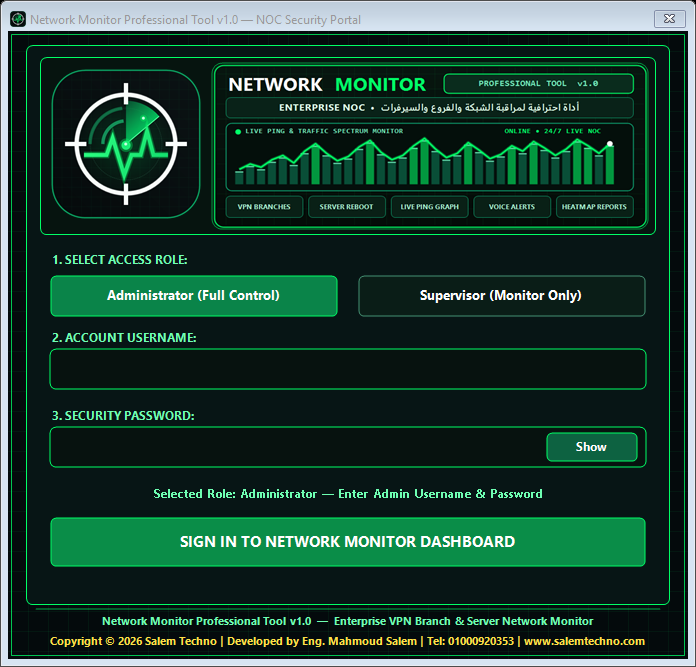

- **🇪🇬 الشرح التفصيلي بالعربية (شاشة تسجيل الدخول):**
  - **`1. SELECT ACCESS ROLE` (اختيار مستوى الصلاحية):** يتيح الاختيار قبل الدخول بين حساب **`Administrator (Full Control)`** لمدير النظام الكامل، أو حساب **`Supervisor (Monitor Only)`** لمشرفي الورديات وغرف المراقبة.
  - **`2. ACCOUNT USERNAME` (اسم المستخدم):** حقل إدخال اسم الحساب المعتمد (الافتراضي للأدمن: `admin` وللمشرف: `supervisor`).
  - **`3. SECURITY PASSWORD` + زر `Show` (كلمة المرور المشفرة):** حقل إدخال كلمة المرور المحمية بتشفير `SHA-256 + Salt` داخل الخزنة المحلية، مع زر **`Show`** لإظهار أو إخفاء الأحرف المكتوبة للتأكد من صحتها قبل الضغط على **`SIGN IN TO NETWORK MONITOR DASHBOARD`**.

- **🇬🇧 Detailed English Explanation (Login Portal):**
  - **`1. SELECT ACCESS ROLE`:** Allows operators to select either **`Administrator (Full Control)`** or **`Supervisor (Monitor Only)`** prior to authentication.
  - **`2. ACCOUNT USERNAME`:** Account identifier field (default `admin` for Administrator, `supervisor` for Supervisor).
  - **`3. SECURITY PASSWORD` & `Show` Toggle:** Verifies credentials against salted cryptographic hashes stored inside the local `AES-256` vault, with a convenient **`Show`** toggle to inspect typed characters before clicking **`SIGN IN TO NETWORK MONITOR DASHBOARD`**.

---

### 🔹 شاشة (F-02): لوحة التحكم والمراقبة الحية الرئيسية | Main Real-Time NOC Monitoring Dashboard

  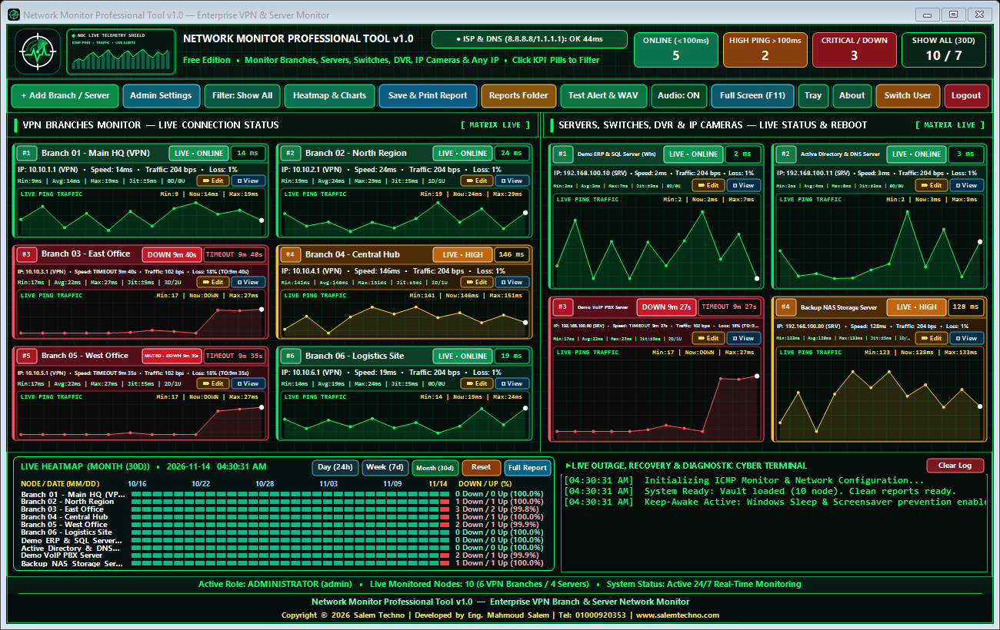

- **🇪🇬 الشرح التفصيلي بالعربية (الشاشة الرئيسية وكافة أزرارها ومؤشراتها):**
  - **شريط صحة الإنترنت العلوي (`ISP & DNS 8.8.8.8 / 1.1.1.1: OK`):** يقيس لحظياً زمن استجابة خط الإنترنت الرئيسي في المقر.
  - **عدادات الفلترة الذكية الأربعة (أعلى اليمين):** تعرض أعداد الأجهزة (`ONLINE <100ms` بالأخضر، `HIGH PING >100ms` بالبرتقالي، `CRITICAL / DOWN` بالأحمر، و`SHOW ALL 30D` لإجمالي سجل الشهر) — الضغط على أي مربع يفلتر الشاشة فوراً.
  - **شريط الأدوات الرئيسي (`Main Action Toolbar`):**
    - **`+ Add Branch / Server`:** فتح نافذة إضافة فرع VPN أو سيرفر أو سويتش أو كاميرا جديدة.
    - **`Admin Settings`:** فتح إعدادات الأمان، الحسابات، منع السكون `24/7`، وسرينة الطوارئ.
    - **`Filter: Show All`:** التبديل السريع بين عرض الكل أو الفروع الفاصلة فقط أو البنج المرتفع فقط.
    - **`Heatmap & Charts`:** فتح شاشة الخرائط الحرارية التفصيلية (`24h / 7d / 30d`).
    - **`Save & Print Report`:** اختيار فترة التقرير (`24 ساعة / 7 أيام / 30 يوماً`) وحفظه وفتحه للطباعة العرضية الفورية.
    - **`Reports Folder`:** فتح مجلد التقارير المحفوظة تلقائياً على جهازك.
    - **`Test Alert & WAV` / `Audio: ON`:** تجربة التنبيه الصوتي والمنبثق فوراً، أو كتم/تفعيل الصوت العام.
    - **`Full Screen (F11)` / `Tray` / `Switch User` / `Logout`:** وضع ملء الشاشة لشاشات العرض، التصغير بجوار الساعة، تبديل المستخدم، أو تسجيل الخروج.
  - **القسم الأيسر (`VPN BRANCHES MONITOR`) والقسم الأيمن (`SERVERS, SWITCHES, DVR & IP CAMERAS`):** يعرض كل جهاز في بطاقة مستقلة توضح الاسم، الـ IP، الحالة (`LIVE - ONLINE` / `LIVE - HIGH` / `DOWN + عداد وقت الفصل`)، الرسم البياني الحي للبنج، وأزرار **`Edit`** للتعديل و **`View`** للفحص المكبر وتتبع المسار.
  - **الشريط السفلي المزدوج:** على اليسار **خريطة حرارية مصغرة لـ 30 يوماً (`LIVE HEATMAP`)** بأزرار (`Day 24h` / `Week 7d` / `Month 30d` / `Reset` / `Full Report`)، وعلى اليمين **سجل الأحداث اللحظي (`LIVE OUTAGE & DIAGNOSTIC CYBER TERMINAL`)** بنظام **12 ساعة (`AM/PM`)**.

- **🇬🇧 Detailed English Explanation (Main NOC Dashboard & Controls):**
  - **Top HQ Uplink Indicator (`ISP & DNS 8.8.8.8 / 1.1.1.1`):** Real-time millisecond health check of headquarters internet connectivity.
  - **Interactive Top-Right KPI Counters:** Live counts for `ONLINE (<100ms)`, `HIGH PING (>100ms)`, `CRITICAL / DOWN`, and `SHOW ALL (30D)` outage/recovery totals; click any pill to filter cards instantly.
  - **Complete Action Toolbar:** Quick access to `+ Add Branch / Server`, `Admin Settings`, `Filter: Show All`, `Heatmap & Charts`, `Save & Print Report`, `Reports Folder`, `Test Alert & WAV`, `Audio: ON/MUTED`, `Full Screen (F11)`, `Tray` (background system tray mode), `About`, `Switch User`, and `Logout`.
  - **Dual Split Monitoring Matrix:** Left grid dedicated to **VPN Branches** and right grid dedicated to **Servers, Switches, DVR & IP Cameras** — each card showing live status badge, continuous timeout duration, `Speed / Traffic / Loss % / Min-Avg-Max-Jitter`, live ping graph, and quick **`Edit`** / **`View`** buttons (plus right-click menu for `Remote Reboot`, `Ping`, `Traceroute`, and `Mute 15m`).
  - **Bottom Split Analytics Dock:** Live interactive mini `24h / 7d / 30d` heatmap on the left (with `Reset` and `Full Report`) paired with the **12-hour (`AM/PM`) Live Outage & Recovery Cyber Terminal** on the right.

---

### 🔹 شاشة (F-03): نافذة إضافة وتعديل الفروع والسيرفرات وكافة إعداداتها | Branch & Server Configuration Editor

  

- **🇪🇬 الشرح التفصيلي بالعربية (إعدادات الفرع أو السيرفر بالكامل):**
  - **`1. DEVICE IDENTITY` (بيانات تعريف الجهاز والملاحظات):**
    - **`Branch / Server Name` & `Display Order #`:** اسم الفرع أو السيرفر وترتيب ظهوره في الشاشة.
    - **`IP Address / Host` & `Type`:** عنوان الـ IP أو الدومين، وتصنيف الجهاز (`VPN Branch` لوضعه في قسم الفروع، أو `Server / Switch / DVR / Camera` لوضعه في قسم السيرفرات).
    - **`Notes / Contact Line`:** مفكرة فنية لحفظ رقم تليفون مسؤول الفرع، رقم الخط الأرضي، أو ملاحظات الصيانة لتظهر في الفحص والتقارير.
  - **`2. PING TIMING, TIMEOUT & LATENCY THRESHOLDS` (توقيتات الفحص وحساسية الإنذار):**
    - **`Ping Every (Seconds)`:** الفاصل الزمني بين كل فحص بنج (مثلاً كل `5 ثوانٍ`).
    - **`Confirm Down After (Mins)`:** المدة المستمرة لانقطاع البنج (مثلاً `4 دقائق`) قبل إعلان السقوط الرسمي ومنع الإنذارات الكاذبة للرمشات العابرة.
    - **`High Ping Warning (ms)` & `Critical Ping Red (ms)`:** حدود تحول لون البطاقة للبرتقالي (`180 ms`) أو الأحمر الحرج (`450 ms`).
  - **`3. DOWN & RECOVERY (UP) AUDIO ALERTS (.WAV + LIVE TEST)` (تخصيص الصوتيات والتكرار):**
    - اختيار الصوت عند السقوط (`When Node Goes DOWN`) وعند العودة (`When Node Recovers UP`) سواء الرسالة الصوتية الإنجليزية الجاهزة (`Auto Voice`) أو ملف صوتي مخصص (`Browse .WAV`) مع أزرار تجربة حية (`Test DOWN` / `Test UP`)، وخيار **تكرار التنبيه الصوتي باستمرار كل `X` ثانية حتى يعود الفرع للعمل**.
  - **`4. ENCRYPTED SERVER REMOTE REBOOT CREDENTIALS` (إعدادات الريستارت عن بُعد):**
    - تفعيل خيار **`Enable Right-Click Remote Server Reboot`** واختيار البروتوكول (`Windows RPC/WMI` أو `Linux SSH` أو `Asterisk PBX SSH`) وإدخال اسم المستخدم وكلمة المرور والبورت لحفظها بتشفير `AES-256`.
- **🇬🇧 Detailed English Explanation (Node Configuration Editor):**
  - **`1. DEVICE IDENTITY`:** Configure `Branch / Server Name`, `Display Order #`, `IP Address / Host`, node category (`VPN Branch` vs. `Server / Switch / DVR / Camera`), and `Notes / Contact Line` (landline number, branch manager contact, or ISP circuit ID).
  - **`2. PING TIMING, TIMEOUT & LATENCY THRESHOLDS`:** Fine-tune `Ping Every (Seconds)`, `Confirm Down After (Mins)` (anti-false-positive confirmation window), `High Ping Warning (ms)`, and `Critical Ping Red (ms)`.
  - **`3. DOWN & RECOVERY (UP) AUDIO ALERTS`:** Assign built-in spoken English voice alerts (`Auto Voice`), sirens, or custom `.WAV` files (`Browse .WAV`) independently for `DOWN` and `UP` events, test them live, and optionally repeat the `DOWN` voice alert every `N` seconds until recovery.
  - **`4. ENCRYPTED SERVER REMOTE REBOOT CREDENTIALS`:** Enable right-click remote reboot over `Windows WMI/RPC`, `Linux SSH`, or `Asterisk PBX SSH` with `AES-256` encrypted credentials and custom TCP port.

---

### 🔹 شاشة (F-04): إعدادات المسؤول، صلاحيات المشرف، منع السكون 24/7 وسرينة الطوارئ | Admin Security, Roles, Keep-Awake & Emergency Siren

  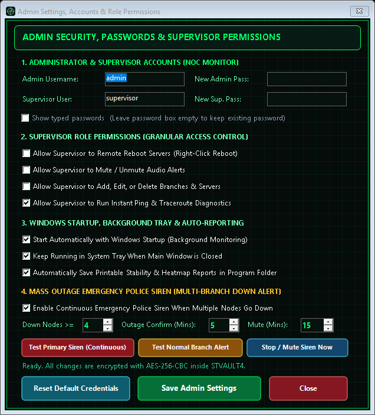

- **🇪🇬 الشرح التفصيلي بالعربية (إعدادات المسؤول والأمان):**
  - **`1. ADMINISTRATOR & SUPERVISOR ACCOUNTS`:** تعديل اسم المستخدم وكلمة المرور لحسابي `Admin` و `Supervisor` (ترك خانة الباسورد فارغة يحتفظ بكلمة المرور الحالية دون تغيير)، مع زر **`Reset Default Credentials`** لاستعادة القيم الافتراضية عند الحاجة.
  - **`2. SUPERVISOR ROLE PERMISSIONS` (التحكم الدقيق في صلاحيات المشرف):** تحديد ما يُسمح للمشرف بفعله بدقة: السماح بالريستارت عن بُعد، السماح بكتم/تشغيل الصوت، السماح بإضافة/تعديل الفروع، أو السماح بأدوات الفحص `Ping & Traceroute`.
  - **`3. WINDOWS STARTUP, BACKGROUND TRAY & AUTO-REPORTING`:**
    - بدء التشغيل التلقائي مع الويندوز (`Start Automatically with Windows Startup`).
    - الاستمرار بالعمل في الخلفية بجوار الساعة عند إغلاق النافذة (`Keep Running in System Tray`).
    - الحفظ التلقائي للتقارير القابلة للطباعة (`Automatically Save Printable Stability & Heatmap Reports`).
    - **منع السكون وشاشة التوقف 24/7 (`Prevent Windows Sleep & Screensaver — 24/7 NOC Keep-Awake`)**.
  - **`4. MASS OUTAGE EMERGENCY POLICE SIREN` (سرينة الطوارئ للسقوط الجماعي):**
    - تفعيل انطلاق سرينة الطوارئ المستمرة تلقائياً عند سقوط عدد معين من الأجهزة في وقت واحد (`Down Nodes >= 4`) لمدة تأكيد (`Outage Confirm: 5 Mins`)، وتحديد مدة الكتم المؤقت (`Mute Mins: 15`) بحيث تعود السرينة للانطلاق تلقائياً بعد 15 دقيقة إذا لم تُحل المشكلة، مع أزرار تجربة وإيقاف فوري!

- **🇬🇧 Detailed English Explanation (Admin Security & Siren Configuration):**
  - **`1. ADMINISTRATOR & SUPERVISOR ACCOUNTS`:** Update `Admin` and `Supervisor` usernames/passwords (leave password blank to keep existing secret) or click **`Reset Default Credentials`**.
  - **`2. SUPERVISOR ROLE PERMISSIONS`:** Granular checkboxes governing whether Supervisor operators can trigger Remote Reboot, Mute/Unmute Audio, Add/Edit/Delete nodes, or run Ping & Traceroute diagnostics.
  - **`3. WINDOWS STARTUP, BACKGROUND TRAY & AUTO-REPORTING`:** Toggle auto-launch on Windows boot, background System Tray persistence on close, automatic HTML report generation, and **`24/7 NOC Keep-Awake`** (blocks Windows Sleep & Screensaver).
  - **`4. MASS OUTAGE EMERGENCY POLICE SIREN`:** Configure the simultaneous down-node threshold (`Down Nodes >= 4`), confirmation minutes (`5 Mins`), and temporary mute duration (`Mute: 15 Mins` with automatic re-arm if mass outage persists), plus instant live test buttons.

---

### 🔹 شاشة (F-05): الخريطة الحرارية الشهرية (30 يوماً) وترتيب الفروع الأكثر انقطاعاً والطباعة العرضية | 30-Day Monthly Stability Heatmap & Executive SLA Reports

  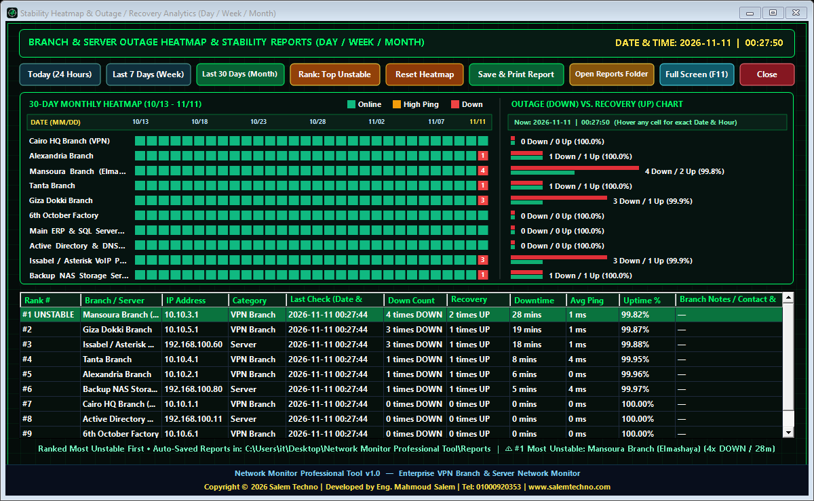

- **🇪🇬 الشرح التفصيلي بالعربية (خريطة 30 يوماً والتقارير التنفيذية):**
  - **مصفوفة الـ 30 يوماً الملونة (`30-DAY MONTHLY HEATMAP`):** تمثل كل خلية يوماً كاملاً لكل فرع أو سيرفر (أخضر = مستقر تماماً، برتقالي = بنج مرتفع، أحمر مع رقم = عدد مرات السقوط المؤكد في ذلك اليوم). تمرير الماوس على أي خلية يعرض تفاصيل اليوم بدقة.
  - **مخطط الانقطاع مقابل العودة (`OUTAGE DOWN vs. RECOVERY UP CHART`):** شريط مقارن بصري يوضح إجمالي مرات الفصل والعودة ونسبة الاستقرار المئوية (`Uptime %`).
  - **جدول الترتيب التلقائي للأعطال (`Rank #1 UNSTABLE`):** يرتب جميع الفروع والسيرفرات تنازلياً من الأكثر انقطاعاً إلى الأكثر استقراراً، شاملاً: عدد مرات السقوط، مرات العودة، إجمالي دقائق التوقف (`Downtime`)، متوسط البنج، نسبة الـ `Uptime %`، وملاحظات الفرع، مع توقيت **12 ساعة (`AM/PM`)**.
  - **أزرار الطباعة والتصفير (`Save & Print Report` / `Reset Heatmap`):** حفظ وطباعة التقرير بالوضع العرضي `A4 Landscape` مرقماً (`Page X of Y`)، أو تصفير السجل الحراري بالكامل لبدء دورة قياس جديدة.

- **🇬🇧 Detailed English Explanation (30-Day Monthly Heatmap & SLA Ranking):**
  - **`30-DAY MONTHLY HEATMAP`:** Visualizes 30 rolling calendar days per device (Green = Online, Amber = High Latency, Red + Counter = Confirmed Outage count on that date) with interactive hover tooltips.
  - **`OUTAGE (DOWN) VS. RECOVERY (UP) CHART`:** Side-by-side horizontal bar chart summarizing cumulative down/up events and overall SLA percentage.
  - **Automated Instability Ranking Table (`#1 UNSTABLE` First):** Sorts all monitored nodes from highest outage frequency/downtime to 100% stable nodes, displaying exact `Last Check` in **12-hour `AM/PM` format**, `Down Count`, `Recovery Count`, `Total Downtime (mins)`, `Avg Ping`, `Uptime %`, and `Branch Notes`.
  - **One-Click `Save & Print Report` & `Reset Heatmap`:** Generates clean `A4 Landscape` multi-page reports (`Page X of Y`) or clears historical counters cleanly after lab testing.

---

### 🔹 شاشة (F-06): الخريطة الحرارية اليومية لـ 24 ساعة بالساعة (`12 AM – 11 PM`) | 24-Hour Hourly Stability Matrix (12-Hour Clock)

  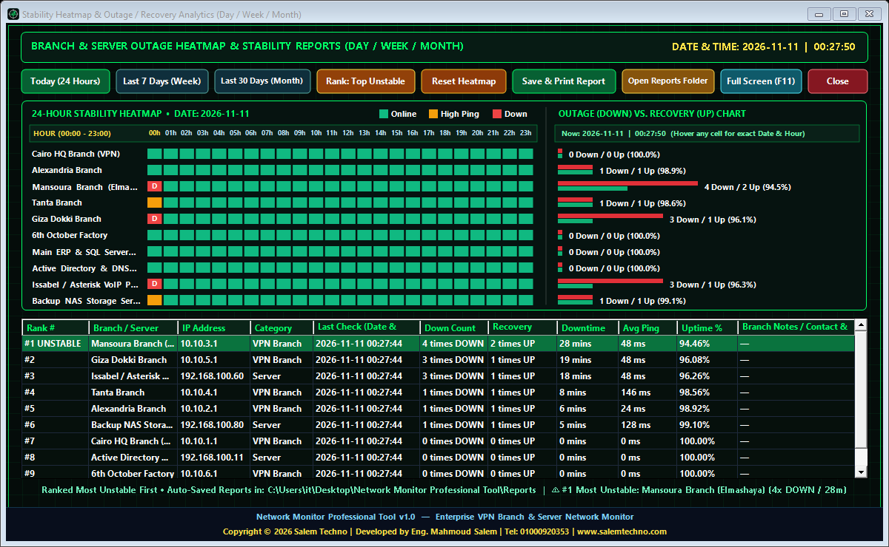

- **🇪🇬 الشرح التفصيلي بالعربية:** عند الضغط على زر **`Today (24 Hours)`**، تتحول المصفوفة لعرض ساعات اليوم الـ 24 ساعة بساعة بنظام الـ 12 ساعة القياسي (**`12A, 1AM, 2AM ... 12P, 1PM ... 11P`**)، مما يكشف فوراً الساعات الدقيقة التي يحدث فيها اختناق الشبكة أو سقوط الفروع (مثل علامة `D` الحمراء في الساعة `4AM` والمربعات البرتقالية للبنج المرتفع).
- **🇬🇧 Detailed English Explanation:** Clicking **`Today (24 Hours)`** switches the matrix into an hour-by-hour intraday timeline (**`12:00 AM – 11:00 PM`**), pinpointing the exact hour of network congestion (Amber) or confirmed disconnections (`D` in Red) across all branches and servers.

---

### 🔹 شاشة (F-07): نافذة الفحص الحي المكبر وتتبع المسار (`[View] + Traceroute`) واختيار فترة الطباعة | Live Node Inspector, Traceroute & Print Period Dialog

  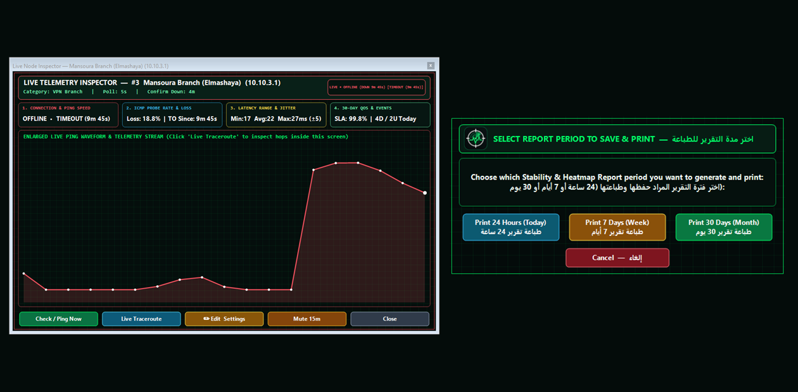

- **🇪🇬 الشرح التفصيلي بالعربية:**
  - **يسار الصورة (`Live Node Inspector — [View]`):** تفتح بالضغط على زر `View` في أي بطاقة، وتعرض 4 لوحات قياس حية (حالة الاتصال وزمن التوقف، نسبة فقد الحزم `Loss %`، مدى البنج `Min/Avg/Max` والـ `Jitter`، ونسبة استقرار 30 يوماً `SLA %`)، مع رسم بياني موجي مكبر وأزرار **`Check / Ping Now`**، **`Live Traceroute`** (لتتبع مسار الراوترات خطوة بخطوة داخل نفس النافذة ومعرفة أين يتوقف الاتصال)، **`Edit Settings`**، و **`Mute 15m`**.
  - **يمين الصورة (`Select Report Period to Save & Print`):** نافذة اختيار نطاق التقرير الثنائية اللغة قبل الحفظ والطباعة (**`24 ساعة اليوم`** أو **`7 أيام الأسبوع`** أو **`30 يوماً الشهر`**).

- **🇬🇧 Detailed English Explanation:**
  - **Left (`Live Node Inspector`):** Opens via `[View]` on any card, providing four dedicated telemetry panels, an enlarged real-time ping waveform, instant **`Check / Ping Now`**, embedded **`Live Traceroute`** (traces hop-by-hop routing directly inside the window without external CMD popups), **`Edit Settings`**, and **`Mute 15m`**.
  - **Right (`Select Report Period Dialog`):** Bilingual modal selector allowing operators to generate and print `24 Hours (Today)`, `7 Days (Week)`, or `30 Days (Month)` landscape SLA reports on demand.

---

### 🔹 شاشة (F-08): الإشعارات الجانبية المنبثقة الفورية فوق سطح المكتب | Instant Desktop Side Outage & Mass Siren Popups

  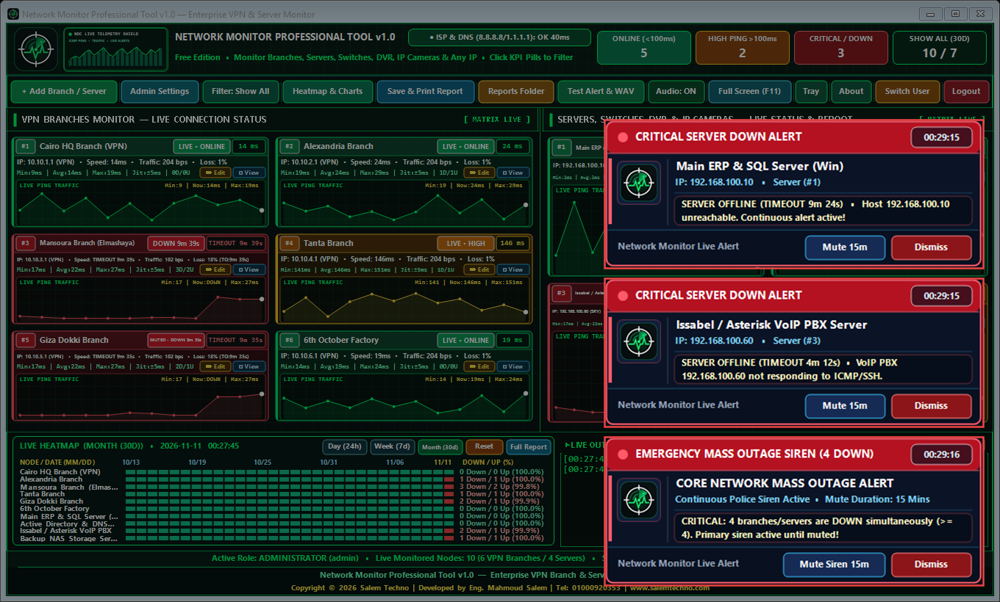

- **🇪🇬 الشرح التفصيلي بالعربية:** توضح اللقطة كيف تنبثق بطاقات الإنذار الحمراء المتراصة في الركن الأيمن السفلي لسطح المكتب فور سقوط سيرفر حيوي (`CRITICAL SERVER DOWN ALERT`) أو انطلاق سرينة السقوط الجماعي (`EMERGENCY MASS OUTAGE SIREN — 4 DOWN`)، موضحةً اسم الجهاز، الـ IP، ومدة التوقف اللحظية، مع زر **`Mute 15m`** لكتم الجهاز مؤقتاً وزر **`Dismiss`** لإغلاق البطاقة، وتعمل هذه البطاقات فوق جميع البرامج الأخرى حتى أثناء تصغير البرنامج في الـ `System Tray`.
- **🇬🇧 Detailed English Explanation:** Demonstrates the non-intrusive yet unmissable stacked desktop toast alerts anchored to the bottom-right corner (`CRITICAL SERVER DOWN ALERT` and `EMERGENCY MASS OUTAGE SIREN`), showing node name, IP address, live timeout duration, **`Mute 15m`**, and **`Dismiss`** — remaining visible above other Windows apps even when the main dashboard is minimized to the System Tray.

---

### 🔹 شاشة (F-09): نافذة معلومات النسخة المجانية والتواصل مع المطور | Free Edition About & Support Dialog

  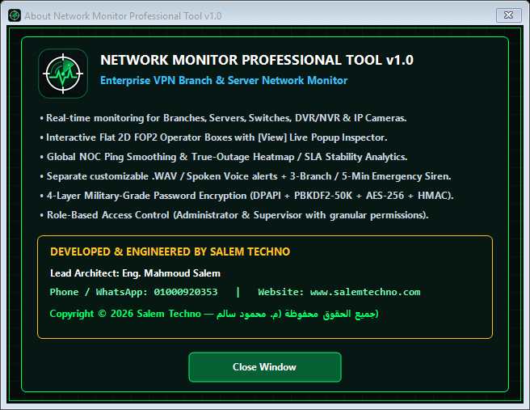

- **🇪🇬 الشرح التفصيلي بالعربية:** تعرض ملخص البنية الهندسية للإصدار المجاني وبيانات التواصل الرسمية مع مطور النظام **م. محمود سالم — شركة سالم تكنو لتكنولوجيا المعلومات (`01000920353` — `www.salemtechno.com`)**.
- **🇬🇧 Detailed English Explanation:** Displays build metadata, architectural highlights of the Free Community Edition, and direct support & upgrade contact details for **Eng. Mahmoud Salem — Salem Techno IT Solutions**.

---
---

  

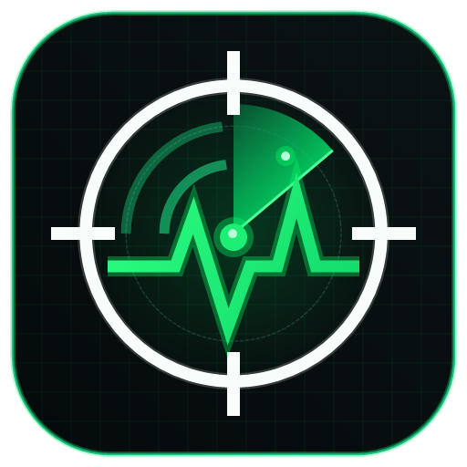

# 🚀 القسم الثاني: شرح نسخة المؤسسات الاحترافية (Enterprise NOC Edition) بالكامل بالصور والإعدادات
# PART II: Enterprise NOC Edition — Complete Exclusive Features & Visual Settings Guide

  
  
  
  
  

> [!IMPORTANT]
> **🇪🇬 لماذا نسخة المؤسسات (`Enterprise NOC Edition`)؟**
> صُممت نسخة **Enterprise** للشركات متعددة الفروع، المصانع، المستشفيات، البنوك، ومراكز البيانات التي تحتاج إلى **عدد غير محدود من الفروع والسيرفرات والأجهزة**، مع ربط مباشر ببروتوكول **MikroTik RouterOS API**، ودعم كامل لإضافة ومراقبة وعمل **ريستارت عن بُعد (يدوي بكليك يمين أو مجدول تلقائياً بنظام 12 ساعة `AM/PM`)** لراوترات الإنترنت في مصر (**WE / Huawei / ZTE / TP-Link / Nokia**)، جدران الحماية (**Sophos XG / XGS / UTM**)، نقاط الـ **Access Points**، وأجهزة **Ubiquiti NanoStation** مع خاصية **الكشف التلقائي عن الموديل (`Auto-Detect`)**، بالإضافة إلى مركز إشعارات موحد يدعم **الواتساب المباشر عبر الـ QR Code بدون API خارجي**، **الإرسال لـ 1 إلى 4 أرقام بقوالب مختلفة لمنع الحظر**، ودعم **Meta Cloud API الرسمي (بقالب Utility اختياري غير إجباري مع تحويل تلقائي للرسائل العادية)**، وتقارير **عدم استقرار الخدمة وتذبذب البنج (`UNSTABLE — NOT DOWN`)**، وخريطة الشبكة التفاعلية (`Topology Map`)، والماسح التلقائي للـ IP!

> [!NOTE]
> **🇬🇧 Why Upgrade to the Enterprise NOC Edition?**
> Engineered for multi-branch enterprises, ISPs, healthcare networks, factories, and data centers requiring **unlimited monitored devices**, native **Master & Sub-MikroTik RouterOS API telemetry + weekly `.rsc` auto-backups**, multi-vendor **Right-Click & 12-Hour (`AM/PM`) Scheduled Remote Reboot** across **Egyptian ISP/WE VDSL/FTTH Routers (`Huawei`, `ZTE`, `TP-Link`, `Nokia`)**, **Sophos Firewalls (`XG/XGS/UTM`)**, **Enterprise Access Points (`TP-Link Omada`, `D-Link`, `UniFi`)**, **Ubiquiti NanoStation (`AirOS`)**, and **Windows/Linux Servers** with **1-Click Smart Model `Auto-Detect`**, unified **Gmail SMTP + Multi-Gateway WhatsApp Center (Built-in Persistent QR Session, 1-to-4 recipient phones with distinct Anti-Ban templates, and Official Meta Cloud API with non-mandatory optional Utility Template & automatic normal-text fallback)**, **Sub-Timeout Ping Flapping Analytics (`UNSTABLE — NOT DOWN`)**, **Interactive Star/Tree Network Topology Map**, **Multi-Threaded Subnet Scanner**, and **Protected Security & Dispatch Audit Logs**.

---

## 🌟 أولاً: الأنظمة والمميزات الحصرية في نسخة المؤسسات | All Exclusive Enterprise Subsystems

1. **♾️ سعة مفتوحة بالكامل (`Unlimited VPN Branches, Servers, Firewalls, Routers, Switches & Cameras`)**
   - **🇪🇬 عربي:** مراقبة عدد غير محدود من الفروع والسيرفرات والراوترات والفايروول والسويتشات وأجهزة الـ NVR/DVR وكاميرات المراقبة في وقت واحد بكفاءة عالية جداً بفضل محرك الفحص غير المتزامن متعدد الخيوط.
   - **🇬🇧 English:** Zero cap on monitored VPN branches, Windows/Linux servers, MikroTik routers, Sophos firewalls, ISP routers, APs, NanoStations, switches, NVRs, and IP cameras.

2. **📡 شريط الميكروتيك الرئيسي والفرعي الحي + النسخ الاحتياطي الأسبوعي (`Master & Sub-MikroTik RouterOS API + Weekly .rsc Backup`)**
   - **🇪🇬 عربي:** شريط علوي مستقل لراوتر **`MASTER MIKROTIK`** وراوترات الفروع **`SUB-MKT`** يتصل مباشرة عبر `RouterOS API (Port 8728)` لقراءة الفروع المتصلة، استهلاك المعالج `CPU %`، الرامات `RAM %`، الهارد `Disk %`، درجة الحرارة `°C`، الفولت `V`، وسرعة السحب والرفع `kbps/Mbps`، مع أخذ نسخة احتياطية `.rsc` تلقائياً كل أسبوع!
   - **🇬🇧 English:** Dedicated top full-width **Master MikroTik VPN Concentrator** banner plus **Sub-MikroTik** cards reading live `CPU %`, `RAM %`, `Disk %`, `Board Temp °C`, `Voltage V`, `Rx/Tx Bandwidth`, and active PPP/VPN tunnels via RouterOS API, plus automated weekly `.rsc` configuration backups.

3. **🌐 دعم شامل لراوترات WE وشركات الإنترنت بمصر + فايروول Sophos + الأكسس بوينت + NanoStation مع الكشف التلقائي (`Multi-Vendor Support + Smart Auto-Detect + Right-Click Reboot`)**
   - **🇪🇬 عربي:** يمكنك إضافة ومراقبة وعمل **كليك يمين -> `Remote Reboot`** بضغطة واحدة لكل من:
     - **راوترات WE وشركات الإنترنت في مصر:** `Huawei (HG630 / HG633 / DG8045 / EchoLife FTTH)`، `ZTE (ZXHN H168N / H188A / H298A / F660 / F670L)`، `TP-Link (Archer VR300 / VR400 / VR600 / TD-W9960)`، و `Nokia Fiber ONT (G-240W / G-2425G-A)`، بالإضافة لأي راوتر قياسي.
     - **جدران الحماية Sophos Firewall:** دعم كامل لموديلات `Sophos XG / XGS (SFOS WebAdmin Port 4444 & SSH)` و `Sophos UTM 9`.
     - **أجهزة الواي فاي Access Points:** جميع موديلات `TP-Link (TL-WA / Archer / EAP Omada)`، `D-Link (DAP / DIR)`، و `Ubiquiti UniFi AP`.
     - **أجهزة الربط اللاسلكي النانو ستيشن (`Ubiquiti NanoStation AirOS`):** `NanoStation M2 / M5 / Loco M2 / Loco M5 / NanoStation 5AC`.
     - **زر الكشف التلقائي الذكي (`🔍 Auto-Detect`):** بمجرد كتابة الـ IP واليوزر والباسورد والضغط على **`Auto-Detect`**، يفحص البرنامج البورتات وبصمة الجهاز (`HTTP/HTTPS/4444/8728/8291/SSH/SMB`) ويختار التصنيف والموديل والبورت تلقائياً!
   - **🇬🇧 English:** Native protocol drivers for right-click remote reboot and monitoring across **Egyptian ISP/WE VDSL & FTTH Routers** (`Huawei`, `ZTE`, `TP-Link`, `Nokia`), **Sophos Firewalls** (`XG/XGS Port 4444 & SSH`, `UTM`), **Access Points** (`TP-Link`, `D-Link`, `UniFi`), and **Ubiquiti NanoStation AirOS** (`M2/M5/Loco/5AC`), complete with a **`🔍 Auto-Detect`** button that probes ports and HTTP/SSH/RouterOS banners to select the exact vendor, model, and port automatically.

4. **⏰ مدير جدولة إعادة التشغيل التلقائي بنظام 12 ساعة + إشعارات الواتساب الاختيارية (`12-Hour AM/PM Scheduled Device Auto-Reboot Manager`)**
   - **🇪🇬 عربي:** نافذة مخصصة لإنشاء جداول إعادة تشغيل دورية (`يومياً Daily` أو `أسبوعياً Weekly` في يوم محدد) لأي مجموعة تختارها من الأجهزة (راوترات WE، فايروول سوفوس، أكسس بوينت، نانو ستيشن، ميكروتيك، سيرفرات) بتوقيت **12 ساعة (`01..12 : 00..59 AM/PM`)**، مع **خيار تفعيل أو إلغاء إرسال إشعار واتساب** عند تنفيذ الريستارت المجدول!
   - **🇬🇧 English:** Create unlimited `Daily` or `Weekly` auto-reboot rules using a native **12-Hour (`AM/PM`) clock** targeting multiple selected routers/firewalls/APs/NanoStations/servers simultaneously, with a per-rule checkbox to **enable or silence WhatsApp execution notifications**.

5. **📲 مركز إشعارات الواتساب المتقدم (QR مباشر + 4 أرقام بقوالب مختلفة + Meta Cloud API بقالب اختياري غير إجباري) وإيميل Gmail SMTP**
   - **🇪🇬 عربي:**
     - **ربط الواتساب المباشر عبر الـ QR Code (`Direct WhatsApp QR Persistent Session`):** ربط مباشر من داخل البرنامج عبر متصفح مدمج مشفر (`Edge / Chrome / Brave`) مع زر **`Generate / Refresh QR`** وحفظ الجلسة بتشفير `AES-256 + DPAPI` لتعمل تلقائياً حتى بعد ريستارت الكمبيوتر بدون أي اشتراكات API!
     - **الإرسال لـ 1 إلى 4 أرقام بقوالب مختلفة لمنع الحظر (`Up to 4 Recipient Numbers + Distinct Anti-Ban Templates`):** يمكنك إدخال رقم واحد أو حتى **4 أرقام واتساب**، ويرسل البرنامج لكل رقم رسالة بصياغة مختلفة من القوالب المحفوظة لنفس العطل مع فاصل زمني بشري وكود عشوائي (`#NOC-XXXX`) لمنع الحظر تماماً، مع تحويل تلقائي للأرقام المصرية المحفوظة بصيغة `010/011/012/015` إلى الصيغة الدولية `201...`.
     - **دعم Meta Official WhatsApp Cloud API بقالب Utility اختياري وذكي:** عند اختيار `Meta Cloud API`، يظهر إعداد **`Optional Meta Template (If Available)`** وزر الدليل الإرشادي **`[Guide]`** لكيفية إنشاء قالب `UTILITY` مقبول في ميتا. **القالب غير إجباري إطلاقاً** — إذا لم تفعّله أو لم يكن متاحاً بعد، يرسل البرنامج الرسائل النصية الاحترافية العادية المتفق عليها تلقائياً بدون توقف!
     - **تنبيهات البريد الإلكتروني الفورية (`Gmail SMTP TLS 587 / SSL 465`):** إرسال تقارير السقوط والعودة وعدم الاستقرار لعدة إيميلات في نفس اللحظة.
   - **🇬🇧 English:**
     - **Built-in Direct WhatsApp QR Session:** Zero-API-fee persistent browser session (`AES-256 + DPAPI`) with one-click **`Generate / Refresh QR`**.
     - **1-to-4 Recipient Numbers with Per-Number Anti-Ban Templates:** Configure 1 to 4 WhatsApp numbers (auto-normalizing local `010/011/012/015` numbers to international `201...`); each recipient receives a distinct saved template variant with human typing delay and unique `#NOC-XXXX` token.
     - **Official Meta Cloud API + Non-Mandatory Optional Utility Template & Guide:** Includes dedicated `Optional Meta Template (If Available)` settings (`noc_device_alert`, language code, and step-by-step **`[Guide]`**). **Templates are strictly optional**: unchecked by default so normal agreed-upon Anti-Ban text alerts dispatch immediately across up to 4 phones. When checked, the engine sends via your approved Meta `UTILITY` template (bypassing the 24-hour customer care window), and **if the template is missing, unapproved, or rejected, it automatically falls back in real time to sending standard Anti-Ban text messages** (and falls back to Direct QR if active) so critical outage alerts are never blocked!
     - **Gmail SMTP Alerts (`Port 587 STARTTLS` & `Port 465 Implicit SSL`):** Multi-recipient HTML/text email dispatch on Down, Recovery, and Instability.

6. **📉 تقرير عدم استقرار الخدمة وتذبذب البنج (`Service Instability & Sub-Timeout Ping Flapping Report — UNSTABLE, NOT DOWN`)**
   - **🇪🇬 عربي:** يكشف الخطوط والأجهزة التي تقطع لثوانٍ معدودة وترجع قبل الوصول لوقت السقوط الكامل (والتي تسبب تقطيع الصوت وبطء الأنظمة دون أن تظهر `DOWN`)، ويصنفها تلقائياً **`UNSTABLE — NOT DOWN`** مع رسم بياني لساعات الذروة وسجل زمني كامل بنظام **12 ساعة (`AM/PM`)** قابل للطباعة والتصدير `CSV`.
   - **🇬🇧 English:** Captures sub-timeout micro-cuts and repeated packet drops that recover before triggering a full `DOWN` alarm, classifying degraded circuits as **`UNSTABLE — NOT DOWN`** with a 24-hour peak flapping chart, intensity ranking, and printable/CSV episode log in 12-hour `AM/PM` format.

7. **🗺️ خريطة الشبكة التفاعلية الحية (`Interactive Visual Star/Tree Network Topology Map`) والماسح التلقائي للشبكة (`Auto IP Subnet Scanner`) وسجل التدقيق (`Security & Dispatch Audit Log`)**
   - **🇪🇬 عربي:** خريطة رسومية حية تربط الإنترنت الرئيسي براوتر الميكروتيك المركزي وكافة الفروع والسيرفرات والفايروول بنقاط مضيئة متحركة، مع ماسح شبكي يكتشف جميع أجهزة الشبكة تلقائياً ويضيفها بضغطة زر، وسجل تدقيق محمي يوثق كل عملية دخول أو تعديل أو إرسال إشعار واتساب/إيميل بنظام `12h AM/PM`.
   - **🇬🇧 English:** Live animated star/tree topology map, multi-threaded IP range scanner with automatic port/vendor fingerprinting (`8728/8291`, `445/3389`, `22`, `80/554`), and tamper-evident Admin/Supervisor + WhatsApp/Email dispatch audit trail.

---

## 🖼️ ثانياً: الشرح المصور الكامل لكافة شاشات وإعدادات نسخة المؤسسات (16 شاشة)
## Screen-by-Screen Visual Guide — Enterprise NOC Edition (All 16 Screens)

---

### 🔷 شاشة (E-01): بوابة الأمان وتسجيل الدخول لنسخة المؤسسات | Enterprise NOC Security Login Portal

  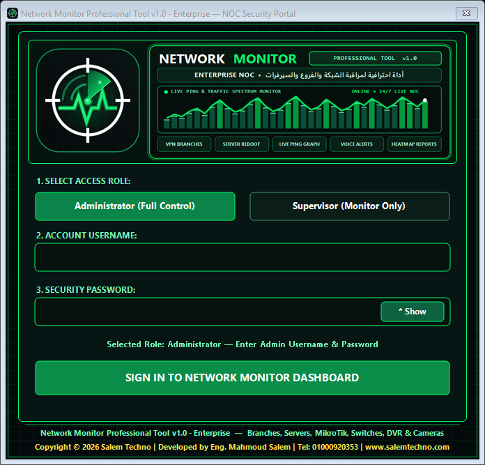

- **🇪🇬 الشرح التفصيلي بالعربية:** بوابة الدخول المشفرة لنسخة المؤسسات (`Enterprise Edition`) للاختيار بين صلاحية **`Administrator (Full Control)`** أو **`Supervisor (Monitor Only)`** مع زر **`* Show`** لمعاينة كلمة المرور، وتسجيل فوري لعملية الدخول بالتاريخ والساعة (`12h AM/PM`) في سجل التدقيق الأمني (`Audit Log`).
- **🇬🇧 Detailed English Explanation:** Enterprise role-based authentication portal (`Administrator` vs. `Supervisor`) backed by `AES-256` vault verification, `* Show` password toggle, and automatic `SESSION_LOGIN` recording inside the Enterprise Security Audit Trail.

---

### 🔷 شاشة (E-02): لوحة التحكم الرئيسية للمؤسسات وشريط MikroTik المركزي ومصفوفة الأجهزة | Enterprise Live NOC Dashboard & Master MikroTik Bar

  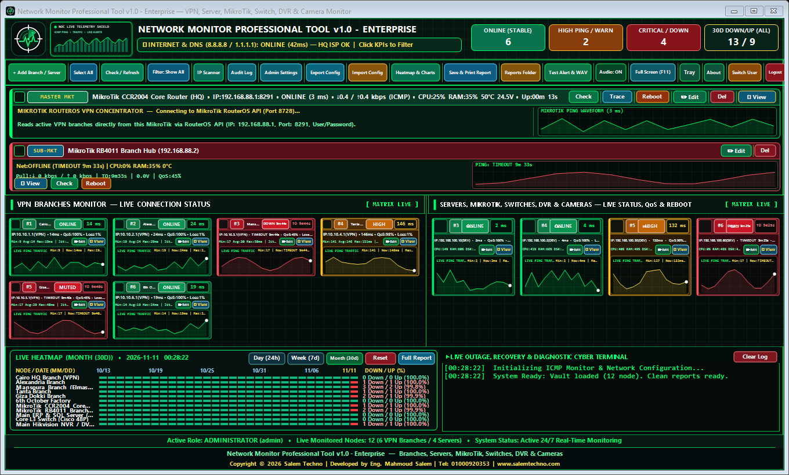

- **🇪🇬 الشرح التفصيلي بالعربية (كافة عناصر الشاشة الرئيسية للمؤسسات):**
  - **شريط الأدوات المؤسسي الموسع:** يضم جميع أدوات التحكم السريع: **`+ Add Device`**، **`Check / Refresh`**، **`Select All`**، **`Filter`**، **`IP Scanner`** (الماسح الشبكي)، **`Reboot Schedule`** (جدولة الريستارت 12 ساعة)، **`Outage Report`**، **`Instability Report`** (تقرير عدم الاستقرار)، **`Notifications`** (مركز الواتساب والإيميل)، **`Audio: ON`**، **`Admin Settings`**، **`Audit Log`** (سجل التدقيق والإرسال)، **`Full Screen`**، و **`Tray`**.
  - **شريط الميكروتيك الرئيسي (`MASTER MKT — MikroTik CCR2004 Core Router`):** يعرض في أعلى الشاشة حالة راوتر الـ Core الرئيسي، البنج، سرعة الترافيك، استهلاك **`CPU %` / `RAM %` / درجة الحرارة `46°C` / الفولت `24.2V` / وقت التشغيل `Uptime`**، الرسم الموجي الخاص بالميكروتيك، وأزرار **`Check` / `Trace` / `Reboot` / `Edit` / `Del` / `View`**.
  - **مصفوفة الفروع والسيرفرات والأجهزة المتعددة:** تعرض الفروع على اليسار، وعلى اليمين تعرض جنباً إلى جنب فايروول **`Sophos XGS`**، راوتر **`WE VDSL`**، جهاز **`Ubiquiti NanoStation`**، **`TP-Link Omada AP`**، والسيرفرات مع مؤشر جودة الخدمة **`QoS %`** ونسبة الفقد **`Loss %`** واستهلاك الموارد، ودعم **كليك يمين -> `Remote Reboot`** لأي جهاز!

- **🇬🇧 Detailed English Explanation (Enterprise Main NOC Dashboard):**
  - **Expanded Enterprise Command Bar:** Instant one-click access to `+ Add Device`, `IP Scanner`, `Reboot Schedule` (12h auto-reboot manager), `Outage Report`, `Instability Report` (ping-flapping analyzer), `Notifications` (SMTP & WhatsApp QR/Meta center), `Admin Settings`, and `Audit Log`.
  - **Dedicated Top `MASTER MKT` Concentrator Banner:** Full-width live telemetry row for the headquarters core MikroTik router (`CPU %`, `RAM %`, `Temperature °C`, `Voltage V`, `ICMP/API Bandwidth`, live waveform, and direct `Check / Trace / Reboot / View` controls).
  - **Multi-Vendor Telemetry Cards:** Simultaneous monitoring of VPN Branches alongside `Sophos Firewall`, `WE VDSL Router`, `Ubiquiti NanoStation`, `TP-Link Access Point`, and `Windows/Linux Servers`, displaying live `QoS %`, `Loss %`, `CPU/RAM/Disk`, and right-click remote reboot actions.

---

### 🔷 شاشة (E-03): محرر الأجهزة المتعدد (راوترات WE، سوفوس، أكسس بوينت، NanoStation، وميكروتيك) وزر الكشف التلقائي `Auto-Detect` | Multi-Vendor Device Editor & Smart Auto-Detect

  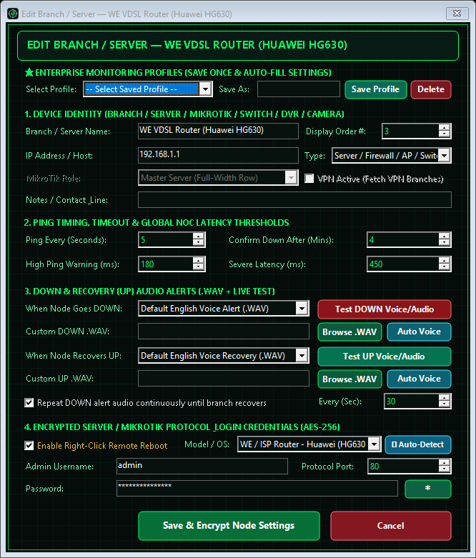

- **🇪🇬 الشرح التفصيلي بالعربية (إضافة وضبط أي جهاز أو راوتر أو فايروول):**
  - **`★ ENTERPRISE MONITORING PROFILES` (القوالب الجاهزة):** احفظ إعدادات البنج والصوت مرة واحدة كقالب (مثلاً `WE Branch Router` أو `Critical SQL Server`) وطبّقها على عشرات الأجهزة بضغطة زر.
  - **`1. DEVICE IDENTITY & MIKROTIK ROLE`:** تحديد اسم الجهاز، الـ IP، التصنيف (`VPN Branch` / `Master MikroTik` / `Sub-MikroTik` / `Server, Firewall, AP, Switch, Camera`)، وخيار سحب فروع الـ VPN تلقائياً من الميكروتيك (`VPN Active`).
  - **`2 & 3. PING THRESHOLDS & CUSTOM .WAV VOICE ALERTS`:** ضبط توقيتات الفحص وحساسية البنج والرسائل الصوتية المنطوقة وتكرار الإنذار.
  - **`4. ENCRYPTED REMOTE REBOOT & SMART AUTO-DETECT` (الريستارت المشفر والكشف التلقائي):**
    - فعّل **`Enable Right-Click Remote Reboot`** واختر من قائمة **`Model / OS`** أي موديل من الموديلات المدعومة:
      - `WE / ISP Router - Huawei (HG630 / HG633 / DG8045 / FTTH)`
      - `WE / ISP Router - ZTE (H168N / H188A / H298A / F660 / F670L)`
      - `WE / ISP Router - TP-Link (Archer VR300 / VR400 / VR600 / TD-W9960)`
      - `WE / ISP Router - Nokia Fiber ONT` & `Generic ISP Router (HTTP/SSH)`
      - `Sophos Firewall (XG / XGS / UTM — Port 4444 / SSH)`
      - `Access Point - TP-Link / Omada` & `Access Point - D-Link / UniFi`
      - `Ubiquiti NanoStation (AirOS M2 / M5 / Loco / 5AC)`
      - `MikroTik RouterOS API / SSH`، `Windows Server (WMI/RPC)`، `Linux SSH`، `Asterisk PBX SSH`.
    - **زر `🔍 Auto-Detect`:** اضغط عليه بعد كتابة الـ IP ليكتشف البرنامج نوع وموديل الجهاز والبورت المناسب تلقائياً في ثوانٍ!

- **🇬🇧 Detailed English Explanation (Enterprise Multi-Vendor Node Editor):**
  - **Reusable Monitoring Profiles:** Save polling intervals, thresholds, and audio profiles once and apply them across new devices instantly.
  - **MikroTik Concentrator Role:** Configure `Master Server (Full-Width Row)` or `Sub-MikroTik` and toggle `VPN Active` to pull active RouterOS PPP/VPN sessions.
  - **Multi-Vendor Remote Reboot & `🔍 Auto-Detect`:** Check `Enable Right-Click Remote Reboot`, enter `Admin Username`, `Password`, and `Protocol Port`, and either choose the exact device driver from `Model / OS` (**WE/ISP Huawei, ZTE, TP-Link, Nokia; Sophos XG/XGS/UTM; TP-Link/D-Link/UniFi APs; Ubiquiti NanoStation AirOS; MikroTik; Windows WMI; Linux SSH**) or click **`🔍 Auto-Detect`** to probe open ports and device signatures automatically!

---

### 🔷 شاشة (E-04): إعدادات المسؤول، منع السكون 24/7 والنسخ الاحتياطي المشفر `.nmcfg` | Enterprise Admin Settings & Encrypted `.nmcfg` Backup

  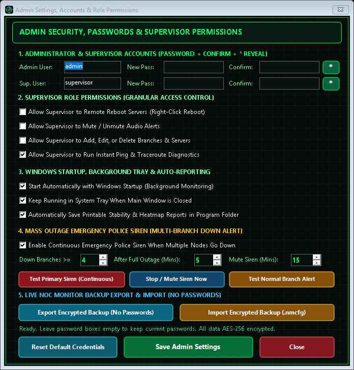

- **🇪🇬 الشرح التفصيلي بالعربية:** بالإضافة لإدارة حسابي الأدمن والمشرف وصلاحيات المشرف ومنع السكون **`24/7 NOC Keep-Awake`** وسرينة الطوارئ، توفر نسخة المؤسسات في القسم الخامس **`5. LIVE NOC MONITOR BACKUP EXPORT & IMPORT (NO PASSWORDS)`** أزرار **`Export Encrypted Backup`** و **`Import Encrypted Backup (.nmcfg)`** لتصدير جميع الفروع والسيرفرات والراوترات وإعداداتها في ملف مشفر آمن لنقله لأي جهاز آخر بدون تسريب أي كلمات مرور، بالإضافة لزر سريع لفتح مركز الإشعارات الموحد.
- **🇬🇧 Detailed English Explanation:** Combines account management, granular Supervisor RBAC, Windows Startup/Tray, **`24/7 NOC Keep-Awake`**, and Mass Outage Siren tuning with **`Export / Import Encrypted Backup (.nmcfg)`** — allowing IT teams to migrate hundreds of configured nodes and thresholds safely across NOC workstations with zero plaintext or password exposure.

---

### 🔷 شاشة (E-05): الخريطة الحرارية الشهرية (30 يوماً) ومؤشر جودة الخدمة `QoS %` والطباعة العرضية | Enterprise 30-Day QoS & SLA Heatmap

  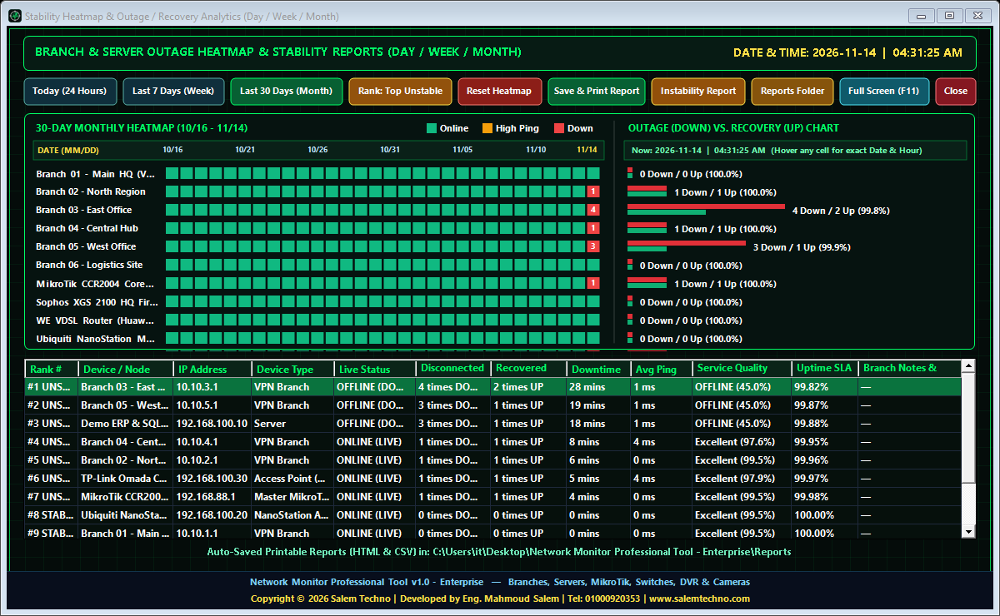

- **🇪🇬 الشرح التفصيلي بالعربية:** تعرض استقرار كافة الفروع وأجهزة الميكروتيك وفايروول سوفوس وراوترات WE والنانو ستيشن على مدار `30 يوماً`، مع عمود حصري لقياس **جودة الخدمة الشاملة (`Service Quality — QoS %`)** الذي يدمج سرعة البنج ونسبة الفقد والتذبذب في تقييم واضح (`Excellent 99.5%` / `Very Good` / `OFFLINE`)، وزر مباشر لفتح **`Instability Report`**، وطباعة تقارير `A4 Landscape` مرقمة الصفحات (`Page X of Y`) بنظام **12 ساعة (`AM/PM`)**.
- **🇬🇧 Detailed English Explanation:** Rolling 30-day enterprise heatmap across all multi-vendor devices featuring the exclusive **`Service Quality (QoS %)`** composite score (combining RTT latency, packet loss, and jitter), automatic `#1 UNSTABLE` ranking, direct jump to **`Instability Report`**, and `A4 Landscape` page-numbered HTML/CSV report export in 12-hour `AM/PM` format.

---

### 🔷 شاشة (E-06): الخريطة الحرارية اليومية لـ 24 ساعة بالساعة (`12 AM – 11 PM`) وجودة الخطوط | Enterprise 24-Hour Hourly QoS Matrix

  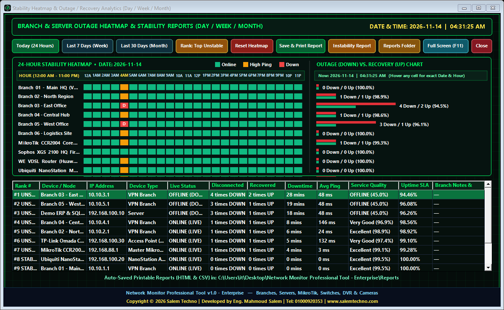

- **🇪🇬 الشرح التفصيلي بالعربية:** تعرض توزيع الاستقرار وجودة الخدمة `QoS %` على مدار ساعات اليوم الـ 24 بنظام **12 ساعة (`12:00 AM - 11:00 PM`)** لكشف ساعات الذروة والاختناق في الفروع أو راوتر الـ WE أو الميكروتيك بدقة، مع إمكانية التصفير الفوري عبر **`Reset Heatmap`**.
- **🇬🇧 Detailed English Explanation:** Intraday 24-hour (`12:00 AM – 11:00 PM`) hourly matrix highlighting exact hours of high latency (Amber) or confirmed outages (`D` in Red) alongside live per-device `Service Quality (QoS %)` and `Uptime SLA %`.

---

### 🔷 شاشة (E-07): نافذة الفحص الحي المتقدم للمؤسسات وتتبع المسار المدمج واختيار فترة التتقرير | Enterprise Live Telemetry & Traceroute Inspector

  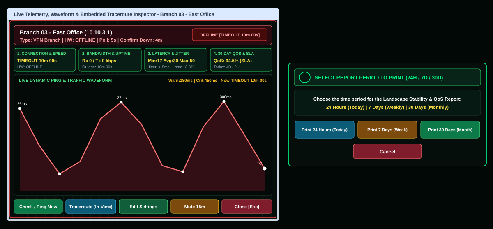

- **🇪🇬 الشرح التفصيلي بالعربية:** تعرض نافذة الفحص المتقدم (`[View]`) في نسخة المؤسسات سرعة السحب والرفع (`Bandwidth Pull`)، مدى البنج والـ `Jitter`، مؤشر جودة الـ 30 يوماً **`QoS %`**، الرسم الموجي المكبر مع خطوط التحذير والخطر (`Warn / Crit`)، وأزرار الفحص الفوري وتتبع المسار المدمج **`Traceroute (In-View)`** وكتم الصوت المؤقت **`Mute 15m`**، وبجانبها نافذة اختيار فترة طباعة التقرير (`24H / 7D / 30D`).
- **🇬🇧 Detailed English Explanation:** Quarter-screen Enterprise Live Telemetry Inspector showing connection state, live bandwidth pull, `Min/Avg/Max` latency & `Jitter`, 30-day `QoS %`, dynamic threshold-annotated waveform, in-window **`Traceroute (In-View)`**, and **`Mute 15m`**, shown alongside the `24H / 7D / 30D` report period selector.

---

### 🔷 شاشة (E-08): الإشعارات الجانبية الحية وطوارئ السقوط الجماعي في نسخة المؤسسات | Enterprise Side Outage Toasts & Mass Outage Siren

  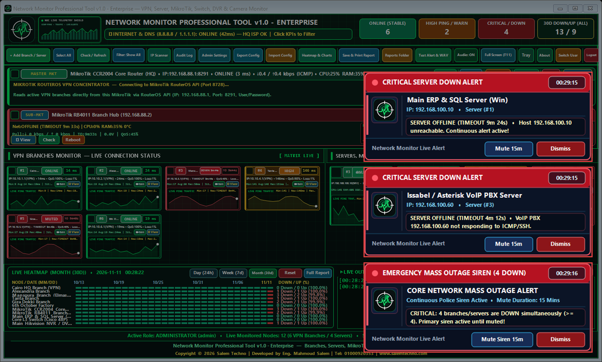

- **🇪🇬 الشرح التفصيلي بالعربية:** انبثاق بطاقات الإنذار الحمراء الفورية في أسفل يمين الشاشة فوق لوحة المؤسسات وشريط الـ `MASTER MKT` والـ `SUB-MKT` عند سقوط سيرفر ERP أو بدالة VoIP أو حدوث سقوط جماعي (`4 DOWN`)، مع أزرار **`Mute 15m`** و **`Dismiss`**.
- **🇬🇧 Detailed English Explanation:** Live bottom-right stacked desktop outage cards (`CRITICAL SERVER DOWN ALERT` & `EMERGENCY MASS OUTAGE SIREN`) overlaying the Master/Sub-MikroTik NOC console with 1-click 15-minute auto-resuming mute controls.

---

### 🔷 شاشة (E-09A): مركز الإشعارات الموحد (1) — إيميل Gmail SMTP + ربط الواتساب المباشر بالـ QR Code + الإرسال لـ 4 أرقام بقوالب مختلفة | Notifications Center (Part 1: Gmail SMTP & Direct WhatsApp QR + 4 Numbers Anti-Ban)

  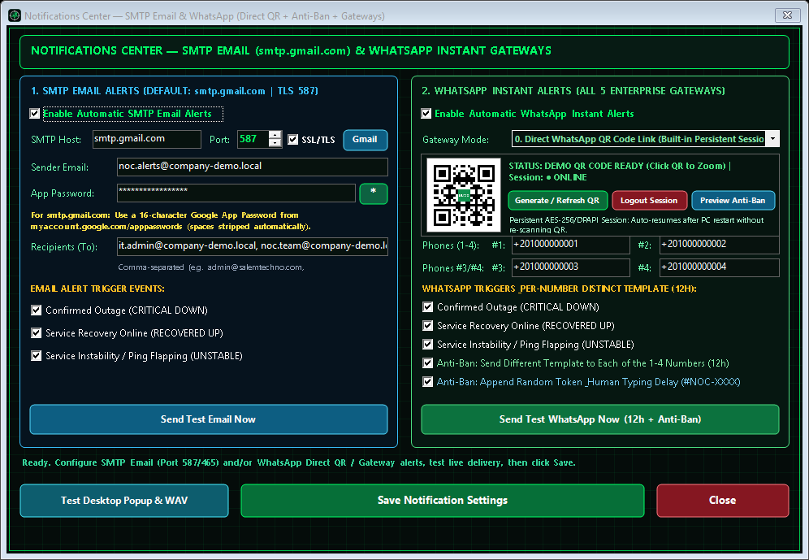

- **🇪🇬 الشرح التفصيلي بالعربية (القسم الأول من مركز الإشعارات الموحد):**
  - **العمود الأيسر (`1. SMTP EMAIL ALERTS — smtp.gmail.com | Port 587 / 465`):**
    - يدعم `Gmail SMTP` بضغطة زر (`Port 587 TLS` أو `Port 465 SSL`) أو أي سيرفر بريد مؤسسي (`Exchange / Office 365 / cPanel`)، مع إدخال `Google App Password` المكون من 16 حرفاً، وإرسال فوري لعدة إيميلات عند السقوط (`CRITICAL DOWN`) أو العودة (`RECOVERED UP`) أو عدم الاستقرار (`UNSTABLE`)، مع زر اختبار فوري **`Send Test Email Now`**.
  - **العمود الأيمن (`2. WHATSAPP INSTANT ALERTS — 0. Direct WhatsApp QR Code Link`):**
    - **ربط مباشر بالـ QR بدون أي اشتراك خارجي:** اضغط **`Generate / Refresh QR`** وامسح الكود من تطبيق واتساب بهاتفك (`الأجهزة المرتبطة -> ربط جهاز`) ليصبح الاتصال **`ONLINE`** فوراً، وتُحفظ الجلسة مشفرة (`AES-256 + DPAPI`) فلا تحتاج لمسح الكود مرة أخرى بعد إعادة تشغيل الجهاز!
    - **إرسال لـ 1 إلى 4 أرقام بقوالب مختلفة لمنع الحظر (`Phones #1 .. #4`):** يمكنك كتابة رقم واحد أو رقمين أو 3 أو **4 أرقام مستلمين** (ويقبل الأرقام المصرية بصيغة `01000920353` أو `+201000920353`)، ومع تفعيل خياري **`Anti-Ban`** يرسل البرنامج لكل رقم رسالة بصياغة مختلفة من القوالب المحفوظة بنظام **12 ساعة (`AM/PM`)** مع تأخير كتابة بشري وكود فريد (`#NOC-XXXX`) لحماية الرقم تماماً من الحظر!

- **🇬🇧 Detailed English Explanation (Notifications Center — SMTP & Direct WhatsApp QR):**
  - **Left Panel (`1. SMTP EMAIL ALERTS`):** Pre-configured for `smtp.gmail.com` (`Port 587 STARTTLS` or `Port 465 SSL`) and custom corporate SMTP relays; supports multi-recipient comma-separated addresses, `DOWN / UP / UNSTABLE` event checkboxes, and live **`Send Test Email Now`**.
  - **Right Panel (`2. WHATSAPP INSTANT ALERTS — Direct QR Mode`):** Built-in persistent browser QR engine requiring zero third-party API keys; includes **`Generate / Refresh QR`**, **`Logout Session`**, **`Preview Anti-Ban`**, **4 independent recipient phone slots (`#1` to `#4`)**, automatic Egyptian phone normalization (`010...` -> `2010...`), per-number distinct Anti-Ban message templates in 12-hour `AM/PM` format, and random `#NOC-XXXX` token injection.

---

### 🔷 شاشة (E-09B): مركز الإشعارات الموحد (2) — ربط Meta WhatsApp Cloud API الرسمي + القالب الاختياري `Utility Template` والدليل الإرشادي والتحويل التلقائي للرسائل العادية | Notifications Center (Part 2: Official Meta Cloud API, Non-Mandatory Utility Template & Auto-Fallback)

  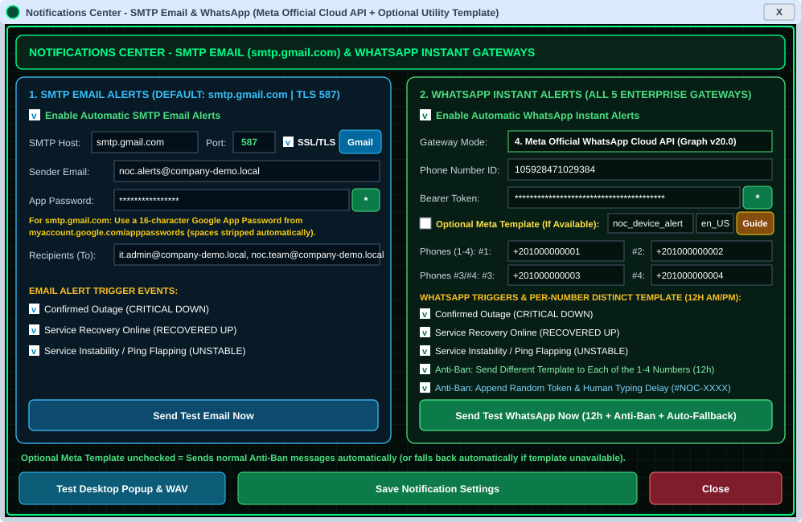

- **🇪🇬 الشرح التفصيلي بالعربية (إعدادات Meta Cloud API الذكية والقالب الاختياري):**
  - عند اختيار **`4. Meta Official WhatsApp Cloud API (Graph v20.0)`** من قائمة البوابات، تظهر حقول **`Phone Number ID`** و **`Bearer Token`**، وتحتها مباشرة شريط القالب الذكي:
  - **`[ ] Optional Meta Template (If Available)` (قالب ميتا اختياري وغير إجباري إطلاقاً):**
    - **الوضع الافتراضي (غير مفعّل):** يقوم البرنامج بإرسال الرسائل النصية الاحترافية العادية المتفق عليها مباشرة (ولكل رقم من الـ 4 أرقام قالب نصي مختلف بنظام 12 ساعة) بدون اشتراط وجود قالب معتمد!
    - **في حال تفعيله:** إذا كان القالب (`noc_device_alert`) معتمداً ومتاحاً في حساب ميتا يرسل به لتخطي نافذة الـ 24 ساعة، **أما إذا كان القالب قيد المراجعة أو غير متاح لأي سبب، يقوم البرنامج تلقائياً في نفس اللحظة بالتحويل وإرسال الرسائل العادية المتفق عليها** (أو الإرسال عبر جلسة الـ QR المباشرة إن كانت متصلة) حتى لا تضيع أي رسالة إنذار!
  - **زر الدليل الإرشادي `[Guide]`:** يعرض خطوات تفصيلية جاهزة للنسخ لكيفية إنشاء قالب من فئة **`UTILITY`** داخل `WhatsApp Manager` بمتغيراته الخمسة `{{1}}..{{5}}` وكيفية استخراج توكن دائم بصلاحية `whatsapp_business_messaging`.
  - كما يدعم مركز الإشعارات أيضاً بوابات **`CallMeBot Free API`**، **`UltraMsg`**، **`Green-API`**، و **`Custom REST Webhook`**.

- **🇬🇧 Detailed English Explanation (Meta Cloud API & Non-Mandatory Utility Template):**
  - Selecting **`4. Meta Official WhatsApp Cloud API (Graph v20.0)`** reveals `Phone Number ID`, `Bearer Token` (with scope diagnostics if a token lacks `whatsapp_business_messaging`), and the **`Optional Meta Template (If Available)`** bar (`Template Name`, `Language`, and **`[Guide]`**).
  - **Non-Mandatory by Design with Automatic Fallback:** Left unchecked by default so normal agreed-upon Anti-Ban text alerts dispatch immediately across up to 4 phones. When checked, the engine sends via your approved Meta `UTILITY` template (bypassing the 24-hour customer care window), and **if the template is missing, unapproved, or rejected, it automatically falls back in real time to sending standard Anti-Ban text messages** (and falls back to Direct QR if active) so critical outage alerts are never blocked!
  - **`[Guide]` Button:** Opens a built-in step-by-step guide with copy-ready `UTILITY` template body (`{{1}}..{{5}}`) for Meta Business Manager approval.

---

### 🔷 شاشة (E-10): تقرير عدم استقرار الخدمة وتذبذب البنج المتكرر (`UNSTABLE — NOT DOWN`) | Service Instability & Sub-Timeout Ping Flapping Analytics

  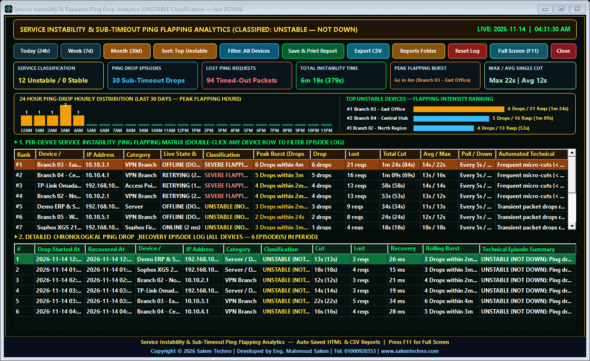

- **🇪🇬 الشرح التفصيلي بالعربية:**
  - أخطر مشاكل الشبكات هي الخطوط التي تفصل لمدة `10` أو `20 ثانية` ثم تعود قبل مرور دقائق تأكيد السقوط الكامل، فتسبب سقوط مكالمات الـ VoIP وفصل برامج الحسابات والـ ERP دون أن تظهر كعطل كامل.
  - تقوم هذه الشاشة الحصرية برصد كل قطيعة قصيرة (`Sub-Timeout Drop`) وتصنيف الجهاز كـ **`UNSTABLE — NOT DOWN`** أو **`SEVERE FLAPPING`**، وتعرض 6 بطاقات إحصائية علوية، مخطط **توزيع ساعات التقطيع على مدار 24 ساعة (`12AM – 11PM`)**، ترتيب أكثر الأجهزة تذبذباً، وجدول السجل الزمني التفصيلي لكل رمشة بالتاريخ والوقت بنظام **12 ساعة (`AM/PM`)**، مع طباعة `HTML` عرضية وتصدير `CSV`.

- **🇬🇧 Detailed English Explanation:**
  - Detects intermittent micro-outages and packet-drop bursts that recover before reaching the full `Confirm Down` threshold — the #1 hidden cause of VoIP call drops and ERP/RDP disconnects.
  - Classifies affected circuits as **`UNSTABLE — NOT DOWN`** or **`SEVERE FLAPPING`**, featuring 6 executive KPI cards, a **24-hour (`12AM–11PM`) Peak Flapping Distribution Chart**, Top Unstable Devices intensity bars, a per-device flapping matrix, and a chronological 12-hour `AM/PM` episode log with printable `A4 Landscape HTML` and `CSV` export.

---

### 🔷 شاشة (E-11): خريطة الشبكة التفاعلية الحية (`Visual Network Topology Map`) | Interactive Live Star/Tree Network Topology Map

  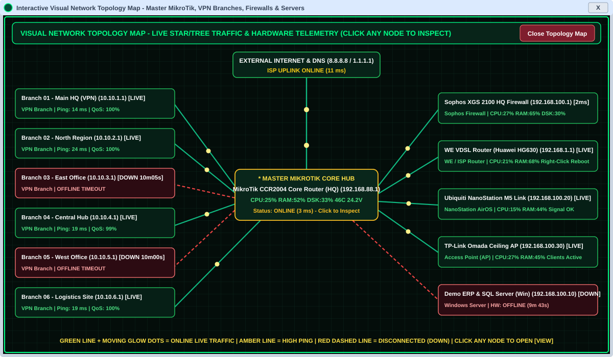

- **🇪🇬 الشرح التفصيلي بالعربية:** ترسم البنية الكاملة لشبكتك تلقائياً بشكل نجمي/شجري حي: يظهر في الأعلى خط الإنترنت الرئيسي (`8.8.8.8 / 1.1.1.1`)، وفي القلب راوتر **`MASTER MIKROTIK CORE HUB`** بقراءات الحرارة والفولت والمعالج، وتتفرع منه خطوط حية بنقاط مضيئة متحركة (`Moving Glow Dots`) إلى كافة فروع الـ VPN على اليسار، وإلى فايروول `Sophos` وراوتر `WE` والـ `NanoStation` والـ `Access Point` والسيرفرات على اليمين (خط أخضر = متصل، برتقالي = بنج مرتفع، أحمر متقطع = فاصل)، والضغط على أي جهاز يفتح شاشة الفحص الحي **`[View]`** فوراً!
- **🇬🇧 Detailed English Explanation:** Dynamically renders a live Star/Tree NOC topology diagram linking external `ISP & DNS Uplink` -> `Master MikroTik Core Hub` -> all `VPN Branches`, `Sophos Firewalls`, `WE Routers`, `NanoStations`, `Access Points`, and `Servers`. Features animated green traffic glow dots on active links, amber lines for high latency, dashed red lines for offline nodes, live `CPU/RAM/Disk` badges, and click-to-inspect navigation.

---

### 🔷 شاشة (E-12): الماسح التلقائي الذكي للشبكة واكتشاف الأجهزة (`Auto IP Subnet Scanner`) | Multi-Threaded Auto Network & IP Range Scanner

  

- **🇪🇬 الشرح التفصيلي بالعربية:** بدلاً من إدخال عشرات الأجهزة يدوياً، اضغط **`Auto Subnet`** لكتابة نطاق شبكتك تلقائياً ثم **`Scan Network Now`**؛ يفحص الماسح النطاق بالكامل في ثوانٍ ويكتشف نوع كل جهاز متاح عبر البورتات المفتوحة (`MikroTik RouterOS 8728/8291`، `Windows Server 445/3389`، `Linux SSH 22`، `Switch/DVR/IP Cam 80/554`) ويوضح الأجهزة المضافة مسبقاً والأجهزة الجديدة، وبضغطة على **`+ Add Checked to Monitor`** تتم إضافتها جميعاً لشاشة المراقبة!
- **🇬🇧 Detailed English Explanation:** High-speed asynchronous IP range scanner with **`Auto Subnet`** detection and TCP port fingerprinting (`8728/8291` MikroTik RouterOS, `445/3389` Windows SMB/RDP, `22` Linux SSH, `80/554` Switch/NVR/IP Camera, plus ICMP gateways). Distinguishes already-monitored hosts from newly discovered devices for 1-click bulk import via **`+ Add Checked to Monitor`**.

---

### 🔷 شاشة (E-13): سجل التدقيق الأمني المحمي وسجل إرسال الواتساب والإيميل (`12h AM/PM`) | Protected Security Audit Trail & Notification Dispatch Log

  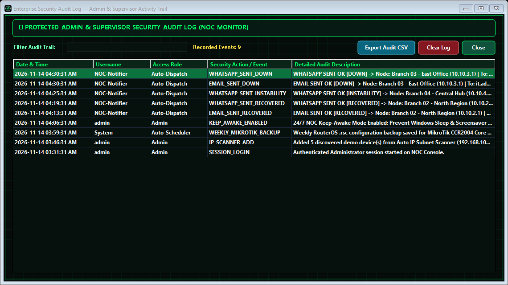

- **🇪🇬 الشرح التفصيلي بالعربية:** يسجل كل حدث إداري أو أمني أو إشعار خارجي بدقة بنظام **12 ساعة (`AM/PM`)** شاملاً: اسم المستخدم، الصلاحية، نوع العملية، والوصف الكامل — بما في ذلك سجل إرسال رسائل الواتساب والإيميل (`WHATSAPP_SENT_DOWN`, `WHATSAPP_SENT_INSTABILITY`, `WHATSAPP_SENT_RECOVERED`, `EMAIL_SENT_*`)، تفعيل منع السكون (`KEEP_AWAKE_ENABLED`)، النسخ الاحتياطي الأسبوعي للميكروتيك (`WEEKLY_MIKROTIK_BACKUP`)، وتسجيلات الدخول، مع خانة بحث فوري وتصدير إلى **`CSV`**.
- **🇬🇧 Detailed English Explanation:** Tamper-evident enterprise audit log with **12-hour (`AM/PM`)** timestamps tracking every `Admin`/`Supervisor` action alongside every automated notification dispatch (`WHATSAPP_SENT_DOWN`, `WHATSAPP_SENT_INSTABILITY`, `WHATSAPP_SENT_RECOVERED`, `EMAIL_SENT_*`, `WEEKLY_MIKROTIK_BACKUP`, `IP_SCANNER_ADD`, `SESSION_LOGIN`), complete with real-time keyword filtering and **`Export Audit CSV`**.

---

### 🔷 شاشة (E-14): مدير جدولة إعادة التشغيل التلقائي للأجهزة والراوترات بنظام 12 ساعة (`AM/PM`) | 12-Hour Scheduled Device Auto-Reboot Manager

  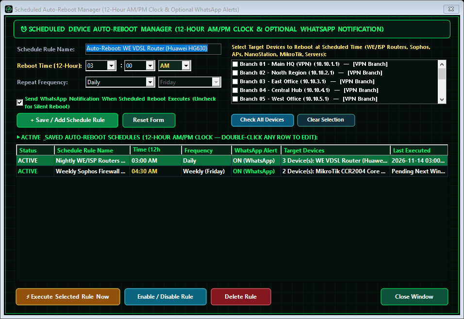

- **🇪🇬 الشرح التفصيلي بالعربية:**
  - صُممت خصيصاً لعمل ريستارت وقائي مجدول خارج أوقات العمل الرسمية (مثلاً الساعة **`03:00 AM`** فجراً كل يوم لراوترات WE أو الساعة **`04:30 AM`** كل يوم جمعة لفايروول Sophos أو الأكسس بوينت أو النانو ستيشن لتجديد جلسات الـ VDSL وتفريغ الرامات).
  - **كافة الإعدادات المتاحة:**
    - **`Schedule Rule Name`:** اسم قاعدة الجدولة.
    - **`Reboot Time (12-Hour)`:** اختيار الساعة (`01..12`) والدقيقة (`00..59`) والفترة (**`AM` صباحاً / `PM` مساءً**).
    - **`Repeat Frequency`:** تكرار يومي (`Daily`) أو أسبوعي (`Weekly` مع تحديد اليوم) أو مرة واحدة (`Once`).
    - **`Select Target Devices`:** تحديد جهاز واحد أو عدة أجهزة معاً من القائمة (`Check All` / `Clear Selection`).
    - **`Send WhatsApp Notification When Scheduled Reboot Executes`:** خيار لتفعيل إرسال رسالة واتساب فور تنفيذ الريستارت المجدول أو إلغاء العلامة لعمل ريستارت صامت تماماً (`Silent Reboot`).
    - جدول القواعد النشطة بالأسفل مع أزرار **`Execute Selected Rule Now`** للتنفيذ الفوري، **`Enable / Disable Rule`**، و **`Delete Rule`**.

- **🇬🇧 Detailed English Explanation:**
  - Automates preventive off-peak maintenance reboots (e.g., refreshing Egyptian VDSL ISP routers nightly at `03:00 AM` or rebooting APs/NanoStations/Firewalls every `Friday at 04:30 AM`).
  - Features a native **12-Hour (`AM/PM`) time picker**, `Daily / Weekly / Once` recurrence, multi-device checklist across all supported vendors (`WE/ISP Routers`, `Sophos`, `APs`, `NanoStation`, `MikroTik`, `Servers`), an optional **`Send WhatsApp Notification When Scheduled Reboot Executes`** toggle (uncheck for silent maintenance), double-click rule editing, and **`⚡ Execute Selected Rule Now`**.

---

### 🔷 شاشة (E-15): شاشة معلومات وترخيص نسخة المؤسسات | Enterprise Edition Official About & Licensing Dialog

  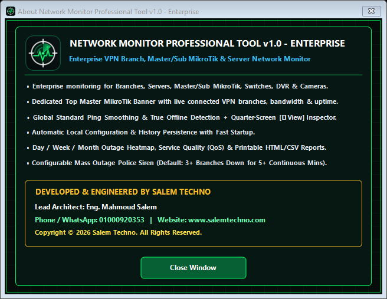

- **🇪🇬 الشرح التفصيلي بالعربية:** توضح ملخص قدرات نسخة المؤسسات (`Enterprise Edition`) وبيانات التواصل المباشر مع مهندس التصميم والتطوير **م. محمود سالم — شركة سالم تكنو لتكنولوجيا المعلومات (`01000920353` — `www.salemtechno.com`)**.
- **🇬🇧 Detailed English Explanation:** Summarizes Enterprise NOC capabilities and provides direct licensing and technical support contact details for **Eng. Mahmoud Salem — Salem Techno IT Solutions**.

---
---

## ⚖️ القسم الثالث: جدول المقارنة الشامل بين النسخة المجانية ونسخة المؤسسات
## PART III: Comprehensive Comparison — Free Edition vs. Enterprise NOC Edition

| الميزة / الخاصية (Feature / Capability — AR & EN) | 🟢 النسخة المجانية (Free Community Edition) | 🚀 نسخة المؤسسات الاحترافية (Enterprise NOC Edition) |
| :--- | :---: | :---: |
| **سعة الأجهزة والفروع (`Maximum Monitored Nodes`)** الحد الأقصى للفروع والسيرفرات المراقبة في وقت واحد | حتى **5 فروع VPN** + **1 سيرفر** *(Up to 5 Branches + 1 Server)* | **غير محدودة نهائياً (`Unlimited`)** *(Unlimited Branches, Servers & Devices)* |
| **مؤشر صحة الإنترنت والـ DNS الرئيسي (`HQ ISP & DNS Health`)** فحص مستمر لـ `8.8.8.8` و `1.1.1.1` بالمللي ثانية | ✅ متاح بالكامل *(Included)* | ✅ متاح بالكامل *(Included)* |
| **الرسم البياني الموجي الحي للبنج + الفقد والتذبذب (`Live Waveform, Loss % & Jitter`)** | ✅ متاح بالكامل *(Included)* | ✅ متاح + مؤشر جودة الخدمة **`QoS %`** |
| **عداد مدة الانقطاع المستمر + فلاتر ذكية (`Outage Timer & 1-Click Filters`)** | ✅ متاح بالكامل *(Included)* | ✅ متاح بالكامل *(Included)* |
| **سرينة الطوارئ المزدوجة + رسائل صوتية `.WAV` + كتم 15 دقيقة تلقائي العودة** | ✅ متاح بالكامل *(Included)* | ✅ متاح بالكامل *(Included)* |
| **الإشعارات الجانبية الفورية فوق سطح المكتب (`Bottom-Right Outage Toasts`)** | ✅ متاح بالكامل *(Included)* | ✅ متاح بالكامل *(Included)* |
| **منع دخول الويندوز والشاشة في وضع السكون (`24/7 NOC Keep-Awake`)** | ✅ متاح بالكامل *(Included)* | ✅ متاح بالكامل *(Included)* |
| **الخرائط الحرارية (`24h / 7d / 30d`) + طباعة `A4 Landscape` مرقمة بنظام `12h AM/PM`** | ✅ متاح بالكامل *(Included)* | ✅ متاح + تحليل **`QoS %`** وتصدير **`CSV`** |
| **إعادة تشغيل سيرفرات `Windows WMI / Linux SSH / Asterisk PBX` بكليك يمين** | ✅ متاح (لسيرفر واحد) | ✅ متاح بعدد غير محدود *(Unlimited)* |
| **شريط ومراقبة راوترات `Master & Sub-MikroTik RouterOS API` + نسخ `.rsc` أسبوعي** | ❌ في نسخة `Enterprise` فقط | ✅ **حصري** (`CPU/RAM/Temp/Volt/VPNs`) |
| **دعم ومراقبة وريستارت راوترات الإنترنت بمصر (`WE / Huawei / ZTE / TP-Link / Nokia`)** | ❌ في نسخة `Enterprise` فقط | ✅ **حصري** (كليك يمين ريستارت فوري) |
| **دعم ومراقبة وريستارت جدران الحماية `Sophos Firewall (XG / XGS / UTM)`** | ❌ في نسخة `Enterprise` فقط | ✅ **حصري** (`WebAdmin 4444` & `SSH`) |
| **دعم ومراقبة وريستارت `Access Points (TP-Link / D-Link / UniFi)` و `Ubiquiti NanoStation`** | ❌ في نسخة `Enterprise` فقط | ✅ **حصري** (`AirOS M2/M5/AC` & `APs`) |
| **خاصية الكشف التلقائي الذكي عن نوع وموديل الجهاز (`🔍 Smart Auto-Detect`)** | ❌ في نسخة `Enterprise` فقط | ✅ **حصري** (يفحص البورتات ويختار الموديل) |
| **جدولة إعادة التشغيل التلقائي للأجهزة بنظام 12 ساعة (`12h AM/PM Auto-Reboot Scheduler`)** | ❌ في نسخة `Enterprise` فقط | ✅ **حصري** (مع خيار تفعيل/كتم إشعار الواتساب) |
| **ربط الواتساب المباشر بالـ QR Code (`Direct Persistent QR — No API Key`)** | ❌ في نسخة `Enterprise` فقط | ✅ **حصري** (جلسة مشفرة دائمة + `Refresh QR`) |
| **إرسال الواتساب لـ 1 إلى 4 أرقام بقوالب مختلفة لمنع الحظر (`1-4 Phones Anti-Ban`)** | ❌ في نسخة `Enterprise` فقط | ✅ **حصري** (رسالة مختلفة لكل رقم بنظام 12h) |
| **دعم `Meta Cloud API` الرسمي بقالب `Utility` اختياري + دليل إرشادي + تحويل تلقائي للرسائل العادية** | ❌ في نسخة `Enterprise` فقط | ✅ **حصري** (`Optional Template + Auto Fallback`) |
| **تنبيهات البريد الإلكتروني الفورية (`Gmail SMTP TLS 587 / SSL 465`)** | ❌ في نسخة `Enterprise` فقط | ✅ **حصري** (متعدد المستلمين) |
| **تقرير عدم استقرار الخدمة وتذبذب البنج (`Ping Flapping: UNSTABLE — NOT DOWN`)** | ❌ في نسخة `Enterprise` فقط | ✅ **حصري** (يرصد الرمشات القصيرة بالساعة) |
| **خريطة الشبكة التفاعلية الحية (`Interactive Star/Tree Network Topology Map`)** | ❌ في نسخة `Enterprise` فقط | ✅ **حصري** (نقاط ترافيك متحركة حية) |
| **الماسح التلقائي الذكي للشبكة واكتشاف الأجهزة (`Auto IP Subnet Scanner`)** | ❌ في نسخة `Enterprise` فقط | ✅ **حصري** (إضافة جماعية بضغطة زر) |
| **سجل التدقيق الأمني المحمي وسجل إرسال الواتساب/الإيميل (`Audit & Dispatch Log`)** | ❌ في نسخة `Enterprise` فقط | ✅ **حصري** (موثق بنظام `12h AM/PM` + `CSV`) |
| **تصدير واستيراد النسخ الاحتياطية المشفرة للإعدادات (`.nmcfg Encrypted Backup`)** | ❌ في نسخة `Enterprise` فقط | ✅ **حصري** (بدون كشف كلمات المرور) |

---

## 💻 متطلبات التشغيل والأمان | System Requirements & Security Architecture

- **نظام التشغيل (`Operating System`):** Windows 10 / Windows 11 / Windows Server 2016, 2019, 2022, 2025 (64-bit & 32-bit) — يعمل مباشرة عبر `.NET Framework 4.x` المدمج في الويندوز بدون أي برامج خارجية.
- **التشفير والحماية (`Cryptographic Vault`):** تشفير كامل لكافة البيانات وكلمات المرور وجلسات الواتساب بمعيار **`AES-256-CBC + PBKDF2 + Windows DPAPI`** محلياً على جهازك فقط دون إرسال أي بيانات لأي طرف خارجي.
- **الأداء الفائق (`Ultra-Light Footprint`):** استهلاك ضئيل جداً للمعالج والذاكرة مصمم للعمل المتواصل `24/7/365` في غرف التحكم والـ NOC.

---

## 📞 التواصل مع المطور وطلب ترخيص نسخة المؤسسات
## Contact Developer & Request Enterprise Edition License

**للحصول على نسخة المؤسسات الاحترافية المفتوحة بالكامل (`Enterprise NOC Edition`) أو لطلب التخصيص والدعم الفني للشركات:**
**To license the full unlimited `Enterprise NOC Edition` or inquire about corporate IT solutions & customization:**

 

**👨‍💻 Lead Architect & Developer:** **Eng. Mahmoud Salem (مهندس محمود سالم)**
**🏢 Company:** **[Salem Techno IT Solutions (سالم تكنو لتكنولوجيا المعلومات)](https://www.salemtechno.com)**
**📞 Phone / WhatsApp:** **`01000920353`** (`+201000920353`)
**🌐 Official Website:** **[https://www.salemtechno.com](https://www.salemtechno.com)**

 

  
  
  

 

Copyright © 2026 <b>Salem Techno IT Solutions — Eng. Mahmoud Salem</b>. All Rights Reserved.

